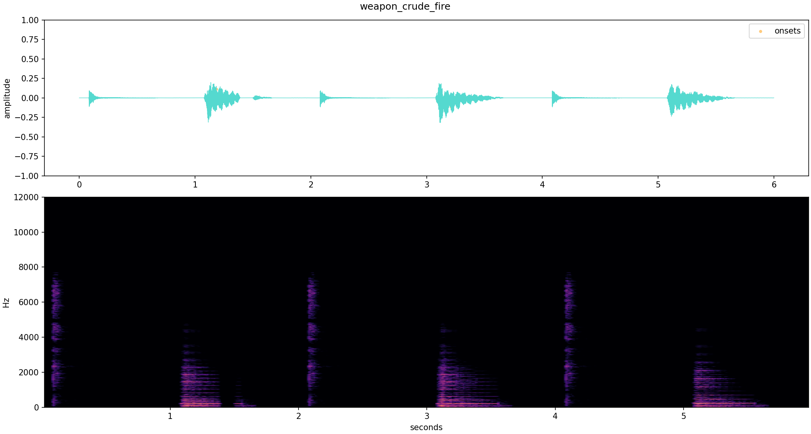

# Groove Flight 录音来源与运行时对应表

2026-11-08更新：当前三类反馈沿用《音频资源.mp4》，护盾按用户指出的28秒附近改用28.745—28.940秒（V26.1单次主声，后续小声音已裁去）；击杀低鼓和清脆拾取素材保留。详见[V26分类音量与反馈](V26_AUDIO_CONTROLS.md)和[当前分析记录](../audio/library/groove_core/analysis/combat-feedback.json)。下文为来源历史。

V17新增 `gameplay_feedback_audio`（用户提供《音频资源.mp4》），提取3种低鼓、护盾和拾取共5个运行文件。另入库的《实机演示.mp4》确认全静音，只作画面参考。源区间、处理与SHA256见 `audio/library/groove_core/analysis/combat-feedback.json`；触发规则见 [V17制作说明](V17_RHYTHM_AND_FEEDBACK.md)。下文7条来源为此前版本清单，当前完整索引以 `catalog.json` 与 `runtime_mapping.json` 为准。

记录日期：2026-11-04。原始参考游戏：`Groove Core Demo`。目标项目：`Groove Flight`。

当前授权资料库有7条来源记录，其中6条已经产生运行时音频；`music_title`是与菜单音乐同源的短摘段，为避免重复加载而保留为来源记录。运行时清单共9个片段，另有2件录音武器对应的16个源事件WAV。

本表是人工核对的来源索引；原始采样率、时长、哈希及加工版本以`audio/library/groove_core/catalog.json`为准，机器可读对应关系见`audio/library/groove_core/runtime_mapping.json`。

## 逐项对应

| 音序核心原始素材 | 原始游戏中的用途 | 源文件 | Groove Flight中的对应 | 运行文件 |
| --- | --- | --- | --- | --- |
| 菜单背景音乐长录音 | 菜单背景音乐 | `audio/library/groove_core/raw/music_menu/菜单背景音乐.mp4.mp3` | 标题页、霓虹港、机库、星球航图背景音乐 | `audio/authorized/menu_theme.ogg` |
| 敌机撞击、我方护盾和敌机生成声音 | 撞击、护盾、敌机生成事件参考 | `audio/library/groove_core/raw/events_enemy_collision/敌机撞击 我方产生护盾声音 和敌机生成的声音.mp3` | 玩家碰撞、敌机受击重低频“咚”、3秒无敌护盾、敌机编队跃迁入场 | `event_collision.ogg`、`event_shield.ogg`、`event_spawn.ogg` |
| 动力推进器 | 动力武器与推进器参考 | `audio/library/groove_core/raw/weapon_power_thruster/动力 推进器.mp4` | 玩家冲刺推进器 | `audio/authorized/thruster_dash.ogg` |
| 天王星关卡 安泊尔背景音乐 | 天王星关卡背景音乐 | `audio/library/groove_core/raw/music_uranus_amber/天王星关卡 安泊尔背景音乐.mp4` | 所有星球的战斗、暂停恢复、编辑器与波间商店共用关卡循环音乐 | `audio/authorized/uranus_amber_loop.ogg` |
| 武器粗制火弹音效 | 粗制火弹与弹道音效参考 | `audio/library/groove_core/raw/weapon_crude_fire/武器粗制火弹音效.mp4` | 原录音0-6秒连续事件组直接用于“裂响火弹”，包含3组2秒强-弱周期 | `weapon_crude_fire_group_6s.wav`；`weapon_crude_shot.ogg` |
| 实弹武器由轻到重 | 实弹武器完整周期参考 | `audio/library/groove_core/raw/weapon_ballistic_volume_ramp/武器实弹的 音乐声音（由轻到重）.mp4` | 合并为单一“实弹连奏炮”，普通/稀有/珍贵三档共用0.58-16.58秒完整十六秒周期 | `weapon_ballistic_cycle_16s.wav`；`rec_ballistic_0.wav`至`_7.wav` |
| 主页面背景音乐 | 主页面背景音乐短段 | `audio/library/groove_core/raw/music_title/主页面背景音乐.mp4` | 与菜单长录音同源，不重复加载；标题页使用`menu_theme.ogg` | 无独立运行文件 |

## 天王星音乐加工链

| 阶段 | 文件 | 规格与处理 |
| --- | --- | --- |
| 原始录像 | `raw/music_uranus_amber/天王星关卡 安泊尔背景音乐.mp4` | 21.20789秒，H.264 + AAC，48kHz双声道 |
| 提取音频 | `working/music_uranus_amber/extracted_audio.wav` | PCM16，48kHz双声道，21.2267秒 |
| 循环母版 | `working/music_uranus_amber/uranus_loop_wav.wav` | 取0.32至20.32秒；10小节、120 BPM；首尾8ms淡化；响度归一化 |
| 游戏运行版 | `audio/authorized/uranus_amber_loop.ogg` | OGG Vorbis q5，48kHz双声道，20.000秒 |

运行时循环只在`active_planet == "uranus"`的战斗和商店状态播放。暂停、音序编辑器和设置界面会暂停当前播放位置；返回战斗后继续播放；离开天王星或进入结算时停止。

循环母版实测峰值为-5.124 dBFS、RMS为-18.845 dBFS；首尾8ms淡入淡出后的边界采样差为0，已避免直接拼接产生爆音。波形检查图见`docs/audio-v12/uranus-amber-loop.png`。

## 录音派生武器

| Groove Flight武器 | 直接截取的连续源区间 | 实际播放文件 |
| --- | --- | --- |
| 裂响火弹 | `0.00-6.00秒` | `audio/authorized/weapon_crude_fire_group_6s.wav` |
| 实弹连奏炮 | `0.58-16.58秒` | `audio/authorized/weapon_ballistic_cycle_16s.wav` |

两个文件均由源提取WAV直接截取为PCM16，不做淡化、增益、归一化、重采样、内部分段或升降调。每个原型有普通、稀有、珍贵三档，共6个战斗条目；三档共用同一原声组，只改变伤害、基础弹数、弹速和穿透。每件条目拥有独立播放器，可以同时装备。

## 使用录音重音层的现有武器

这些合成武器目前只保留历史映射，已从实战、商店和试听中停用；不再叠加运行时短重音。

| 武器家族 | 武器 | 叠加录音 | 触发规则 |
| --- | --- | --- | --- |
| 机炮 | 脉冲机炮、白矢连射器、星针狙击器 | `weapon_crude_shot.ogg` | 每次有效武器触发 |
| 霰弹 | 星砂霰弹、七彩折光匣、碎陨重霰炮 | 实弹轻/中/重音 | 按四拍强度选择录音层 |
| 轨炮 | 苍穹轨炮、地平线终奏 | 实弹轻/中/重音 | 按四拍强度选择录音层 |
| 地雷 | 引力雷荚、花簇雷阵、深井锚雷 | 实弹轻/中/重音 | 按四拍强度选择录音层 |
| 回旋刃 | 回锋弯月、双月交响刃、折返棱刀 | 实弹轻/中/重音 | 按交替四拍选择录音层 |

当前实战只有2个录音原型、6个品质条目直接播放录音原声组。

两个录音武器原型在图鉴中显示“录音原声组”，试听与战斗读取各自的同一个WAV。16个当前 `rec_*` 事件WAV作为事件区间和兼容记录保留。

## 来源哈希

| 来源ID | 原始文件SHA256 |
| --- | --- |
| `music_menu` | `28d231694c0172ba3d267b344869fb5f75ab48694926f572e47d81797c698b4a` |
| `events_enemy_collision` | `d90f1029aaef12250335b9cb2397fa6e815e64cce6c856871945ed8607b1416d` |
| `weapon_power_thruster` | `18f9403c4003693f8ee45f8c659fa7a2d9ccb19bc897cd7d4b9ec35e5e32c721` |
| `music_uranus_amber` | `ea73b72e3a463887454b63127408ece6f17ee9ea0568086c5ee087c50a8fc6a4` |
| `weapon_crude_fire` | `060a1fbd92599e8b0a30f24a729893df8ee0ede37f7238d8aa52ac39776d826d` |
| `weapon_ballistic_volume_ramp` | `9cae3735d3781f263bda7cb32f011147ada3b5d96a2038e9ab00db2733ef572e` |
| `music_title` | `cb2aa77876bd7c56aa99f9fc9897f8651fb00cc46f75ba09127d809097aafee2` |

轻、中、重短音的修正点分别为`0.60-0.98秒`、`22.10-22.48秒`、`33.10-33.86秒`。原先约`0.45 / 22.90 / 47.90秒`的截取点落在静音或尾音间隙，已不再用于运行文件。连续组边界位于相邻事件之间的静音区，不会截断起音或尾音。

四条待播放原声组的完整段波形检查图、截取起止和源文件哈希同时登记在`audio/library/groove_core/analysis/recorded-weapon-groups.json`。粗制火弹原声组波形：

