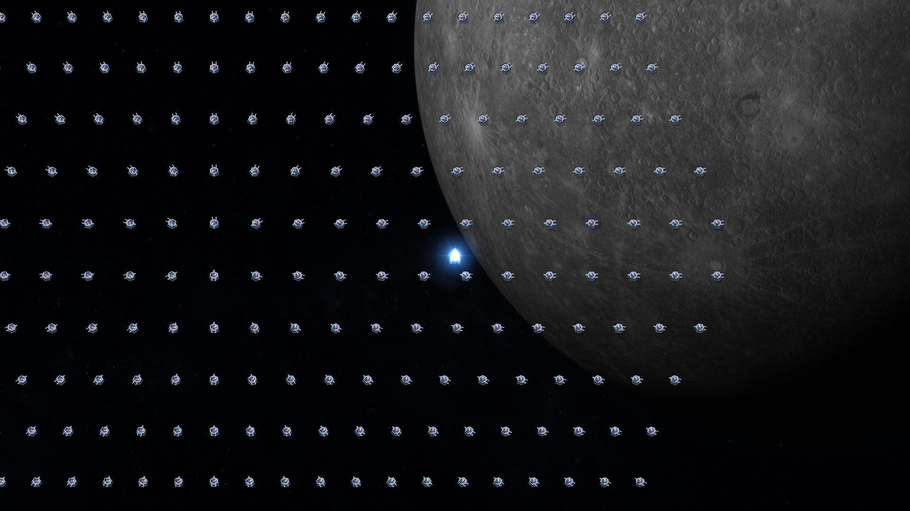
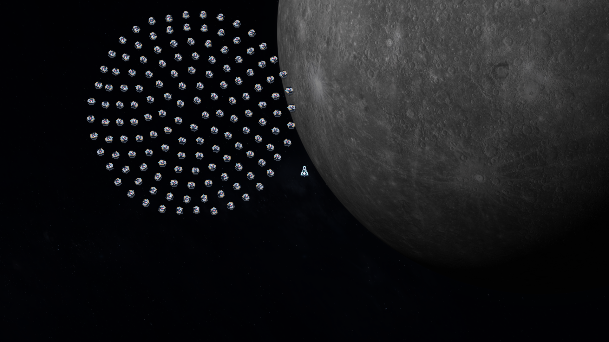

# 方阵与圆阵敌机：分布、追击、包围与建模

日期：2026-11-07。参考：用户本地视频 `E:/安泊尔57天王.mp4`，重点为7:00—7:30、8:35及之后约10秒，以及两张用户截图。本文是当前制作约定；后文区分视频观察、用户要求与实现状态。

## 核心体验

敌群在大地图上逐步形成包围。近处散兵以弧形、扇形持续施压，远处单位可在视野外绕行，从侧后方再次进入画面。玩家通过输出打出缺口，也可以用走位和冲刺穿过尚未闭合的包围。

大战场为12288×12288游戏单位；设计画面1920×1080，镜头缩放0.65，对应可见地图约2954×1662，相当于整张地图约30.8个屏幕面积。

出生队形负责出场的规模感；每架敌机随后拥有自己的运动状态、路线进度和避让判断。镜头只决定显示范围，不能决定敌机是否继续运动。

当前音序器维持1秒一轮，普通敌机每0.5秒推进一次，约0.22秒移动、0.28秒停顿。普通敌机以身体接触造成伤害，取消普通机远程炮弹；精英和Boss专属攻击另行保留。

## 参考画面能说明什么

| 位置 | 可直接观察的画面 | 用于本项目的要求 |
| --- | --- | --- |
| 7:18附近、1920×1080参考截图 | 大片紧密行列，单架轮廓仍可辨认，部分阵列超出画面 | 大批次、同型号、明确行列与间隔，允许远处兵力在镜头外继续行进 |
| 8:34.5—8:36.5附近 | 红色圆形点阵扩大，呈多层环状分布，随后显出敌机 | 圆阵以一个中心向外展开，并具备红色出场预告 |
| 8:37—8:39附近 | 靠玩家一侧受到攻击、出现缺口，余部保持弧面并逐渐散开 | 近端先形成攻击压力，远端继续扩展包围 |
| 用户第二张放大截图 | 舰体有顶面和深色侧面，单位间仍有空隙 | 保留完整个体轮廓，补充厚度、统一受光与遮挡 |

参考大矩阵粗估14—16列、35—40行，约500—650架；先以600架作为后期大批次的验证目标。清楚的方块敌机机身约16—22屏幕像素，横向中心间距约30—35像素、纵向约24—30像素。这些均为截图估算，受裁切、透视和特效遮挡影响，不作为源游戏精确参数。

“最近的一部分先攻击、其他单位包围”和“在看不到的地图区域绕行后出现”是用户明确要求。上述短片不能证明源游戏内部采用何种寻路、索敌或避让算法。

## 一、方阵敌人

### 分布与出场

- 一批只使用一种普通敌机建模；不同批次可使用不同型号。
- 红色区域和点位预告出生范围，预告结束后完整批次出现。新出生位置必须避开玩家、已有敌机和其他待生成区域。
- 使用矩形行列，包括接近正方形的方阵和较长的矩阵；不引入菱阵。600架的首个完整验证布局为25列×24行，后续可按进攻方向调整长宽比。
- 早期、小批次和后期、大批次分别调节，不能在第一波直接灌入后期数量。批量上限与当前存活上限分别管理。
- 行列间距按舰体的完整外轮廓计算。碰撞核心半径不能直接充当机翼外缘，长机身与宽翼型号需要更大的净空。
- 出场预告期间若旧敌机进入该区域，应重新预告空闲位置或延后生成。

### 追击与包围

1. 出生后先用约3秒向大战场疏散：上部向上、下部向下，中部形成平滑扇面过渡。纵向位移按所在行连续变化，中部逐渐增加横向展开；不在中心用一条水平线硬切方向。疏散进度先加速后减速，保持半秒步进。
2. 按空间区域分而治之：为不同部分提供宽阔的地图区域和不同的绕行深度；局部碰撞只影响真正相邻的单位。避免全军继承一个阻塞点，也避免散开后又被导向同一个狭窄航点。
3. 根据每架敌机相对玩家的距离、方位和所在侧翼分配后续任务。
4. 靠玩家一侧的一部分先推进，逐步形成弧形、扇形压力；每架有自己的接近方向，转向应有惯性。
5. 外侧单位向两翼展开，在大地图上绕行。它们的目标是取得侧后方接近位置，路线可以暂时离开镜头。
6. 玩家远离后，敌机隔一段时间修正包围目标；保持正在进行的绕行趋势，避免目标位置每帧跳变。
7. 到达侧翼或接近玩家后，个体转入近身进攻。被击杀造成的缺口应当真实存在，并随余部运动自然变化。

出生矩阵不应成为绑定全体单位的移动刚体。密集单位因相互避让而暂时同向推进是正常现象，但不能永久共享一个队形中心、固定槽位和统一转向。

## 二、圆形敌人

### 分布与膨胀

- 圆阵是用户新增确认的第二种入场方式，与方阵并存；此前“只使用方阵”的限制由本次补充更新。
- 一批同型号敌机围绕一个出场中心，以多层同心环或近似圆盘分布；各层保留完整机身所需的间隔。
- 红色预告从中心向外展开；显形后的敌机先沿各自径向继续外扩，形成“从原点膨胀”的效果。
- 原点是视觉上的出场源。实际实体应从具有净空的点位显形或分批释放，避免把所有有碰撞的机身重叠在同一个坐标。
- 扩散距离、持续时间、环数、每环数量和批次间隔分别配置；扩大圆阵时保持角向和径向净空。

### 最近者先攻、远端包围

1. **展开阶段：**每架沿自己的径向运动，先拉开空间。
2. **近端进攻：**根据展开后相对玩家的距离选出最近的一部分，转入接近与攻击。进攻面自然成为圆阵朝玩家一侧的弧段。
3. **两翼绕行：**其余单位根据所在圆周方位分向两翼，延续外扩后进入包围路线。
4. **外围合围：**远端在镜头外继续行动，到达侧后方或接近玩家后再加入进攻。

最近者的比例是可调参数，不把整个圆盘同时改为直冲。玩家移动后应定期、带滞后地修正任务，防止全体单位突然交换路线。

## 三、个体避让与进攻节奏

每个半秒节拍同时读取邻近单位的位置和计划运动，规划本拍位移。避让必须检查整个移动过程，防止两个安全终点之间发生交叉穿透。

- 前方拥堵时，允许沿侧向滑动、减速或等待；后排不能直接穿过前排。
- 普通敌机保持完整可辨的轮廓。允许尾焰、投影和受击光晕交叠，舰体主体应留有净空。
- 远近任务不同，但使用同一套局部避让规则；包围路线只给个体提供方向，不取消个体碰撞空间。
- 镜头外仍执行路线和避让。渲染可裁切，逻辑不能因不可见而停摆或直接传送到玩家附近。
- 分裂产生的新机也要寻找空闲位置；没有空隙时延后或向邻近空区释放。
- 出场节奏要形成推进、交锋、空档和下一批次，给玩家观察与突破的机会。

## 四、建模与俯视立体感

首选在现有2D战斗逻辑上制作2.5D观感。仅凭参考视频无法确认其底层是否全部使用真实3D。

| 项目 | 制作要求 |
| --- | --- |
| 机身比例 | 普通敌机与我方战机处于相近体量级；按1920×1080实机对照，避免缩成小点 |
| 单批一致性 | 同批使用同一型号、尺寸规则与材质语言，保留单架自己的朝向和受击状态 |
| 体积 | 明确顶面、深色侧壁、装甲厚度、核心和引擎，减少纯图标感 |
| 光照 | 统一世界受光方向，侧壁与顶面明暗有区别，转向后仍保持一致的光源方向 |
| 视角 | 轻微俯视压缩与高度偏移，投影和尾焰提供层次；战斗判定仍以明确的平面位置为准 |
| 可读性 | 灰白装甲与敌方红色核心保持辨识；我方弹幕有不同颜色，受击盾光避免长时间盖住敌群 |
| 大批渲染 | 使用共享网格和实例渲染，每架保留位置、朝向、闪光和可见性，不能合并为一张整群贴图 |

## 五、实现状态与验收

已接入红色方阵/圆阵预告、同型号整批出生、600架完整矩阵、3秒上下疏散及中部连续过渡、圆阵膨胀、近端先攻、视野外绕行、局部防重叠与立体舰体。验收包含600架15秒运动、展开范围与拥堵比例，以及圆阵52.5秒路线样本。当前通过波次结束会撤走余部，跨波保留敌机尚未实现；具体结果见 `data-v21/SUMMARY.json`，不以文档代替实际验证。

最新600架样本：3秒覆盖面积约为出生时9.27倍，疏散时滞留原地0架；中部相邻行的目标间距连续，未出现中心断层。15秒末滞留0架，近端攻击者平均距离从约441降至287游戏单位，远端继续利用地图空间绕行。圆阵样本中97架外围单位曾离开镜头，其中44架在52.5秒观察内再次进入画面。这些是特定种子、无敌与受控时间下的机制结果。

实机截图：

验收须同时覆盖：方阵/圆阵出生录像；最近者先攻与两翼分流；敌机离开镜头后继续运动并重新出现；运动全程净空；被击杀后的真实缺口；半秒推进、暂停冻结与普通机零远程弹；600架场景性能；完整个体与舰体厚度的GPU实机截图。

短时无敌脚本测试仅验证机制和性能边界，不能替代真人难度、听感和长期游玩验收。每一轮游戏修改前必须先上传并核验Git备份，完成后也要上传可复查版本。
