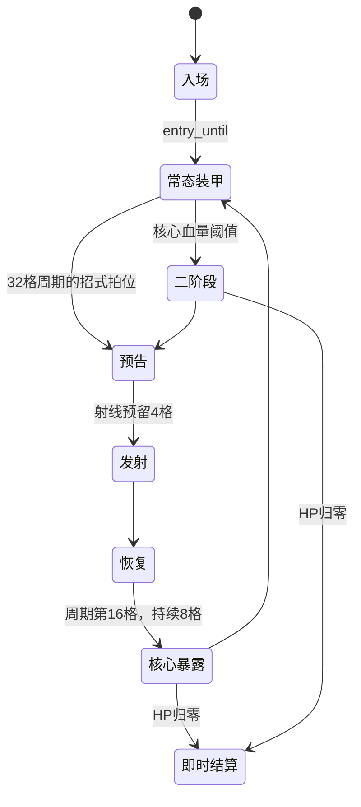

# V11 时间、弹道、音频与经济协议

本文件描述实际实现；完整范围与限制见测试报告。表格原始数据由 `tests/v11_export_tables.gd` 导出为 `data-v11/tables.json`。

## 单位与事件

普通音序：120BPM，1拍0.5秒，8格/四拍小节，每格0.25秒。钢琴卷帘：每拍四细分，使用曲谱BPM。共同适配器 `music_clock.gd` 输出秒、BPM、拍、小节、相位、细分、循环与延迟字段。原生流时间修正使用最近混音时间减输出延迟；首个mix以前不采用上一条音轨残留的修正。

事件包括 schema、event_id、deadline、serial、track、slot/source_slot、uid/root_uid、root_event、pitch_midi、velocity、duration、repeat_index、depth、trajectory。`source_slot`保留回声复奏的原始条件位置。普通与作曲各自调度器补齐字段，没有强行改变原有格位含义。

三连事件位于本格的0、1/3格、2/3格，120BPM下分别为0、83.333、166.667毫秒。碰撞、移动、拾取立即处理。仅未来子事件进入pending队列；暂停保留队列，换装后重新生成当前格尚未来到的子事件，避免回放过去事件。

128秒PCM覆盖最高8小节充能的完整8音动机。三条缓存，准备任务可取消；工作线程只读主线程快照，不加载场景资源。普通起步和换装走异步准备，缓存采用时保留当前音频位置、循环和步号。离线WAV导出保留同步合成接口；设置关闭时的同步fallback仍可能短暂停顿，后续应进一步消除。

测量分为计划deadline、主线程actual、原生音频时间和物理输出。程序actual误差不包含显示器扫描、蓝牙/USB额外延迟及人耳定位误差。未完成回环录音校准。

## 伤害与实际弹数

```
单发伤害 = 基础伤害 × 舰体系数 × (1+.45×(装备等级-1))
          × max(.1,1+对应属性/100+动力/200)
          × 单发伤害倍率 × max(.1,1+规则伤害+同家族连奏)
属性弹数 = floor(max(0,对应属性) × 匹配的每属性弹数规则)
额外弹数 = clamp(round(全局额外弹数+武器弹数规则)+属性弹数,-80,80)
实际弹数 = clamp(基础弹数+额外弹数,1,家族上限)
```

家族上限：电弧8束、光束12束、其余96发；电弧传导最多32目标。武器等级最高4，支援规则等级比例 `1+.35×(等级-1)`。同轨与相邻贡献只作用匹配目标；相邻按宽装备的实际边缘计算。伤害在最终健康变更处只记一次有效值及过量值，子弹按根UID归属。

充能向下量化到1/2/4/8小节，8减1的结果为4；UI展示实际值。支持规则：全局/同轨/相邻，目标家族或主属性，首末/奇偶/充能等条件。逐条解释见240装备表。

交叉组件将同轨弹道属性×0.50转换为弹数，并在接触时产生4个26%伤害的子弹；动力慢拍组件的系数0.12，能量导电组件的额外弹数0.12、传导系数0.10。这些转换会与普通属性伤害相乘，因此完整构筑需要单独平衡。

## 弹道管线与预算

基础武器 → 作用域匹配 → 属性/等级/伤害 → 充能资格 → 微时序事件 → 三轨实际挂点与偏移 → 速度/加速/延迟转向 → 立即碰撞 → 有限衍生 → 根UID统计。

每次根事件衍生预算128、深度最多2；分裂仅首个有效接触一次，子弹清空分裂规则，不能自我繁殖。衍生数组和伤害归属可重现。逻辑弹体上限4096；满载后的新请求进入延后队列，其存续从真正接纳开始，不静默删除。**极端构筑会因此延迟攻击，相位也可能不再准确**；尚未提供损失等价、低成本的逻辑聚合，不能将此策略称为无限密度支持。渲染只裁剪不可见几何，低特效关闭光晕、降低碎片，不改伤害和碰撞。

## 声音角色与并发

32件武器使用原有独立音源与包络配方，文件位置、音区、衰减、调频、充能和旋律列于32武器表。三轨采用等功率声像 -0.46/0/+0.46。背景默认0.45、武器0.34、支援0.12；复奏音量0.75，回声驾驶员0.55。PCM使用tanh软限幅。伴奏每8小节在0.85和1间变化，作用范围为背景层。

音乐由原生播放器输出；瞬态分为hit/kill/ui各4声部，alert2声部。金属、爆破等重复装饰限流75毫秒，其他35毫秒；击杀按45毫秒聚合，增益最多3dB。普通/装甲/精英/Boss瞬态分别55/95/190/420毫秒。受击和奖励路由到保留alert组；Boss死亡也使用alert。记录played、limited、aggregated与stolen。

这是四组播放器层级，尚未为每个细类建立独立音量滑杆或完整侧链压缩；危险预警目前主要依靠视觉锁定与既有金属提示，逐招专属音频仍待制作。无真人试听结论。原始素材与本次生成说明见 `audio/CREDITS.md`。

## 编队与Boss状态

编队局部坐标一直保留：0—2秒入场、2—5秒列阵、5—12秒推进、12秒后解散进入既有职责AI。按拍点平滑加速，速度包络0.72—1.40，最短武装缓冲1秒。弧阵转向、楔阵横移、双流交错、星座收缩/旋转等共享连续插值。全体领队被击破后的战术重组尚未完整实现；当前也不是每支编队都具有单独设计的提示动画。



| 星球 | 空间机制 | 玩家破解与恢复 |
|---|---|---|
| 水星 | 两条钻臂锁定射线，间隔扇形弹 | 避开锁定通路，拆2炮塔，8秒周期核心爆发 |
| 金星 | 左右交替月扇与中线射线 | 向相反侧穿越空区 |
| 地球 | 成对斜向闸门射线 | 观察门间空隙，之后处理正面扇弹 |
| 火星 | 提前1秒锁定目的地，突进后平滑复位 | 离开突进通路，在恢复期反击 |
| 木星 | 反向双螺旋 | 沿持续角度缺口移动，避免追着螺旋内旋 |
| 土星 | 玩家周围内收环带，留移动缺口 | 朝环带缺口切出，再躲锁定线 |
| 天王星 | 横纵交替平行列 | 利用中心留白，提前向下一空区移动 |
| 海王星 | 交叉呼叫与滞后扇形应答 | 先读射线再离开后续扇面 |

外置炮塔真实可击破；水星2座、其他3座。每座对核心造成8%最大生命结构伤害，结构伤害不再乘弱点1.5。部分扇弹数量随存活节点变化；并非每种招式都由炮塔控制。二阶段共享额外追击，星球主机制分别编写，待完整平衡与演出细化。

## 经济与表格

6件报价互异；首项保留武器。波1—3最高稀有，波4—6开放史诗，波7起传奇。权重为 `(1+品质×幸运×.04)×流派亲和`，已拥有相关核心时每件增加0.20，亲和总上限2。

第2报价在波2后有75%概率使用空间/复奏/充能/和弦候选袋；第3报价65%概率为防御。锁定商品从新池排除，保留价格。基础价格乘 `1+.025×(波-1)` 并取整；刷新起始8，后续涨价见实际UI；合成消耗同级同型号副本，最高4级，回收按基础价格×0.4×等级系数。

外圈每星从新配装起步，因此生命、伤害、移速、弹速倍率根据本星商店进度渐增到原最高威胁。初始超额系数分别0.22、0.12、0.40、0.30。每波保留原时间与预算，逐项见67行配置表。预算为计划上限，分裂增援会增加实际生成，结算以真实生成和真实撤退为准；撤退不算击杀，不发掉落。

## 重跑与数据导出

设置 `GODOT_PATH` 后用Python运行 `tools/run_v11_tests.py`；参数为测试名，可加 `--gpu` 或 `--gpu --forward`。`v11_export_tables`导出原始JSON，`tools/export_v11_csv.py`生成Excel可读表。联合负载是 `v11_dense_review`；数值模拟为 `v11_balance_sim`；全长辅助录像为 `--gpu --movie v11_native_sample`。

性能GPU计时采用Godot[RenderingServer官方接口](https://docs.godotengine.org/en/stable/classes/class_renderingserver.html#class-renderingserver-method-viewport-set-measure-render-time)；它只覆盖渲染，不能当成总帧耗时。内存为Godot静态分配统计，并非整个进程工作集。
