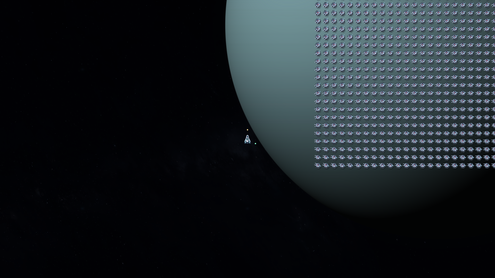
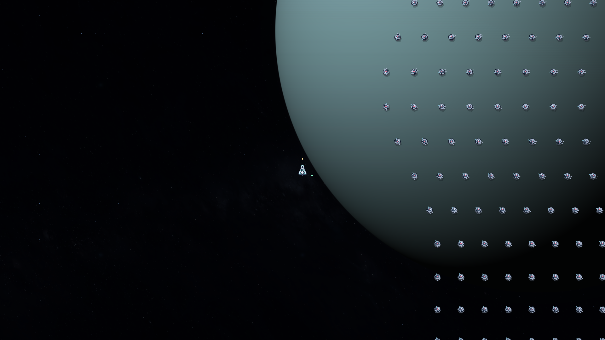

# V21.1 出生区域与玩家通道

2026-11-07，版本 `0.21.1-safe-arrivals`。按用户要求，敌群优先从战机侧方、后方生成，避免战机落在阵列中心或展开路径中央。

原先只排除了出生方框内的玩家，展开时仍可能扩大到玩家两侧。本次将出生区域与完整计划展开区域一起检查，并向玩家外侧调整展开中心；方阵中部的连续过渡和圆阵的径向展开继续保留。

- 近场至少预留360游戏单位，当前镜头约234屏幕像素；出生方框避开前向850游戏单位的即时行进通道。
- 空间充足时，优先侧方和后方。地图边缘可选择更远的安全位置，保持世界边界约束。
- 大批次可以横跨画面侧缘；出生区域在镜头外时，画面边缘显示红色方向标和脉冲预告。
- 0.8秒预告结束时，再按玩家当时的位置和行进方向复查。玩家进入出生或展开区域时，原位置不生成，重新选址并给出完整预告。
- 没有安全位置时，取消当前预告，等待下一次生成检查；没有实际出生的单位不扣波次预算。
- 这些规则保护初始生成与计划展开。出生后玩家驶入敌群，继续按正常接触伤害处理。

专项使用8个方向、3种波次布局、4个地图位置，共96组条件，均找到安全生成位置。地图中央24组全部选择侧后方；地图边缘允许更远的安全候选。实际展开过程中，测试的机身与玩家最近净空约379—485游戏单位；玩家闯入预告区域时没有单位直接显形在身上。

验证结果见 [V21.1数据](data-v21.1/SUMMARY.json)。这是受控条件下的专项检查，原V21性能与完整机制报告保留在 `data-v21/`，未将旧性能样本标成新版本实测。

