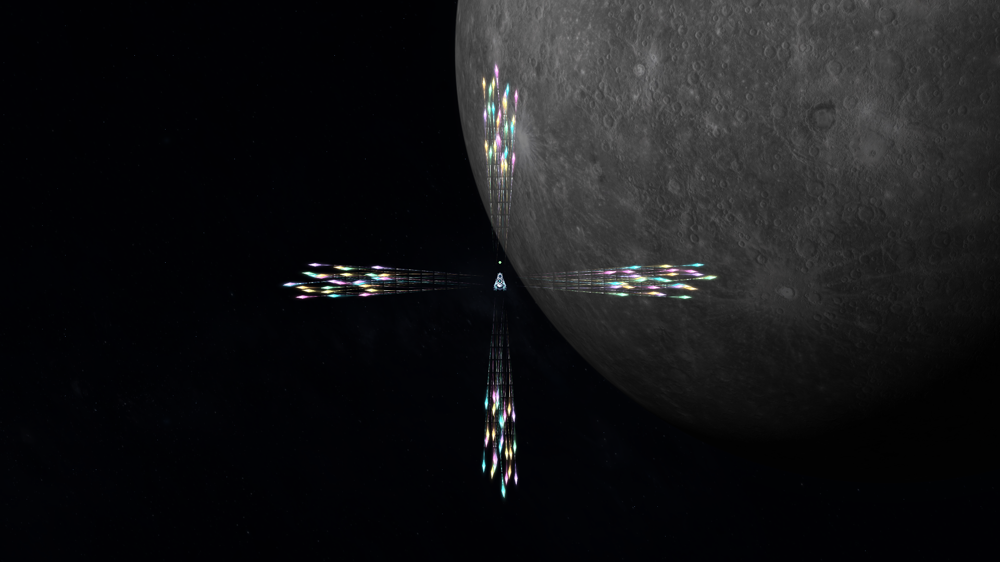
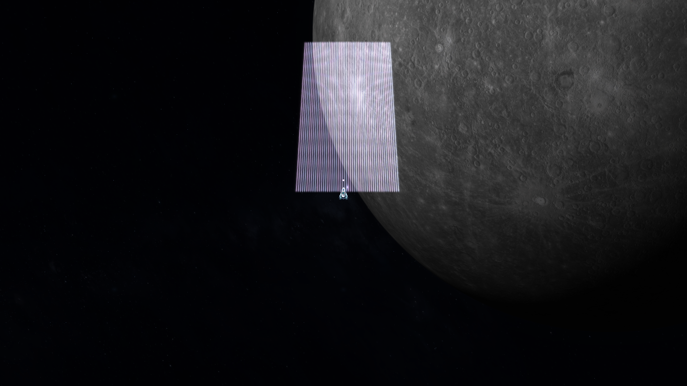
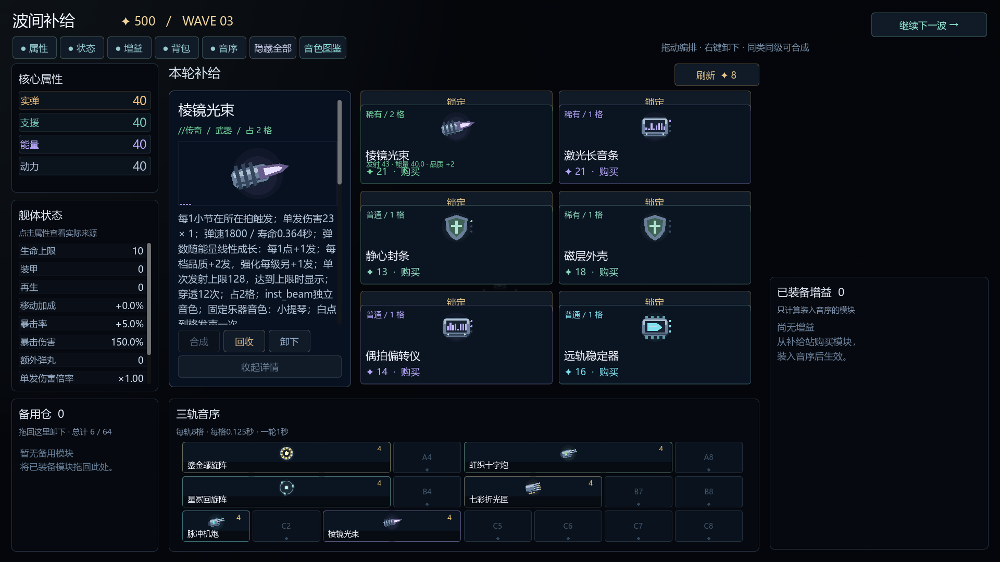

# V22：四属性弹数成长与上方出场

2026-11-07，版本 `0.22.0-attribute-barrages`，分支 `codex/v22-attribute-barrages`。

本轮保留：敌群从我方上方、左上方、右上方出场；武器弹数与实弹、支援、能量、动力对应属性线性关联，品质提高也增加弹数。用户随后明确撤销刚才的弹头和光晕调整，已恢复调整前视觉。

## 发射数量

15种现役武器共用同一个结算入口，商店预估、已装备详情、战斗发射读取相同规则：

`实际弹数 = 基础弹数 + round(对应属性 × 系数) + 品质档位 × 2 + (强化等级 − 1) + 改件/额外弹丸`

- 默认系数为1。实弹影响实弹武器，能量影响能量武器，动力影响导弹，支援影响星冕回旋阵。其他属性不会重复给该武器加弹数；原有伤害加成继续生效。
- 属性来自舰体、已装备模块、核心和波间强化。未装备模块不提供属性，不凭空增加属性来源。原有同轨、相邻、节拍条件与专门的弹道改件继续参与对应武器结算。
- 普通、稀有、史诗、传奇对应档位0、1、2、3。有效品质为 `min(基础稀有度 + 强化等级 − 1, 3)`；合成仍要求同类同级模块，最高Lv.4。品质达到传奇后，继续强化只保留每级额外1发。
- 每件武器保留自己的基础散发方式与基础数量。没有把原本的全向、四向或螺旋阵列全部改成单发。
- 单次上限：普通弹体256、激光128、电弧64个起始分支。面板显示上限状态。实际并发仍受既有弹体池与特效池限制，不能理解为无限弹幕。

| 示例 | 对应属性0、Lv.1 | 对应属性40、Lv.4 |
| --- | ---: | ---: |
| 脉冲机炮 / 实弹 | 3 | 52 |
| 棱镜光束 / 能量 | 3 | 50 |
| 七彩折光匣 / 实弹 | 16 | 61 |
| 鎏金螺旋阵 / 能量 | 52 | 97 |
| 虹织十字炮 / 实弹 | 70 | 113 |
| 星冕回旋阵 / 支援 | 20 | 65 |

棱镜光束高配示例：`50 = 基础1 + 能量40 + 品质6 + 强化3`。每一束都有独立起点与实际命中；不是反复在同一条线上加亮。光束命中使用空间格穿越查询，并按距离消耗穿透次数。电弧以不同近端目标分配起始分支，再继续各自跳跃。

## 视觉回退范围

用户选择“只撤销刚才的弹头和光晕调整，保留属性弹数与上方出兵”。以下六个文件完整恢复到`94d8bf7`，并以Git逐文件对照确认一致：`scripts/weapon_visuals.gd`、`scripts/weapon_render.gd`、`scripts/weapon_emission.gd`、`shaders/weapon_body.gdshader`、`shaders/weapon_glow.gdshader`、`shaders/weapon_effect.gdshader`。

恢复调整前的弹头尺寸、长尾迹、完整曲线尾带、光晕、激光宽度、弹列间距和28毫秒排间隔。属性/品质弹数结算、额外真实光束、空间命中查询、上方出生与安全复查均保留。星冕随数量扩展的3—8层也保留。

这些弹体真实飞行、命中、穿透或爆破，数量变化也会增加实际输出。此轮完成机制和视觉验证，八星自然成长曲线与真人难度仍需试玩调整。演示采用明确的后期高属性配装，不表示开局就有这份火力。

## 敌群出场

最新方向要求覆盖V21.1的“侧后方优先”：出生候选只有屏幕/世界坐标的左上、正上、右上，带小角度偏移。整片出生区域的下沿至少位于玩家上方360游戏单位；出生到展开结束的扫掠区域也须给玩家留出净空。该方向不随机头或飞行朝向旋转。

保留0.8秒红色预警、同批同型号、完整方阵或圆阵、旧敌机占位检查和显形时复查。巨型方阵可以部分位于镜头外，通过红色方向标预告。在地图上边界没有足够安全空间时延后出场，不改为玩家脚下或下方出生。预告结束时按当前玩家位置重新计算安全展开区域，避免细微移动导致不必要的持续重预告。

出场后仍是独立个体：方阵约3秒平滑疏散；圆阵先径向展开；近端形成弧形、扇形压力，远端沿大地图绕行。普通机每0.5秒行进一步且不射击。完整机制见[敌群文档](ENEMY_FORMATIONS_AND_ENCIRCLEMENT.md)。

## 音乐与验证

音序器仍为3轨×8格、每格0.125秒、一轮1秒。白点扫到起始格播放一次固定乐器声，同种武器不同实例可以叠奏。增加弹列不增加额外声音事件；四拍强弱和自动变调仍搁置。现有120份样本未替换。

现版原始验证与受控场景范围保存在 [data-v22/SUMMARY.json](data-v22/SUMMARY.json)，包括15武器成长组合、真实弹体与逐束命中、原生GPU、敌群净空/包围、固定声音及反馈回归。撤销的视觉尝试及未完成的性能诊断保留在回退前备份中，不作为当前通过结果或性能结论。

[8秒原生弹幕预览](video-v22/attribute-barrage-preview.mp4)采用1920×1080、受控时间、六把Lv.4武器、四主属性40、无敌和静音条件。用于查看密度、光晕和上方入场，不替代真人听感、平衡或持续帧率验收。

## 入口与备份

- `scripts/projectile_growth.gd`：数量、品质、上限与面板公式。
- `scripts/weapon_emission.gd`、`scripts/weapon_visuals.gd`：实际发射位置、排间距、弹道与独立美术参数。
- `scripts/weapon_render.gd`、`shaders/weapon_*.gdshader`：已恢复的弹头、尾迹与光晕。
- `scripts/arsenal_screen.gd`：四主属性和真实发射数量。
- `scripts/enemy_arrival.gd`、`scripts/main.gd`：上方候选、预告结束时的安全展开复查。

本轮修改前上传并核验的快照：`codex/backup-20261107-before-attribute-volley`（`3410c45`）、`codex/backup-20261107-before-linear-weapon-growth`（`45f8ba2`）、`codex/backup-20261107-before-projectile-grains`（`94d8bf7`）。这些分支保留供回看。

视觉回退前的完整尝试保存在 `codex/backup-20261107-before-projectile-rollback`（`c9b23da`），已上传并核验SHA。
