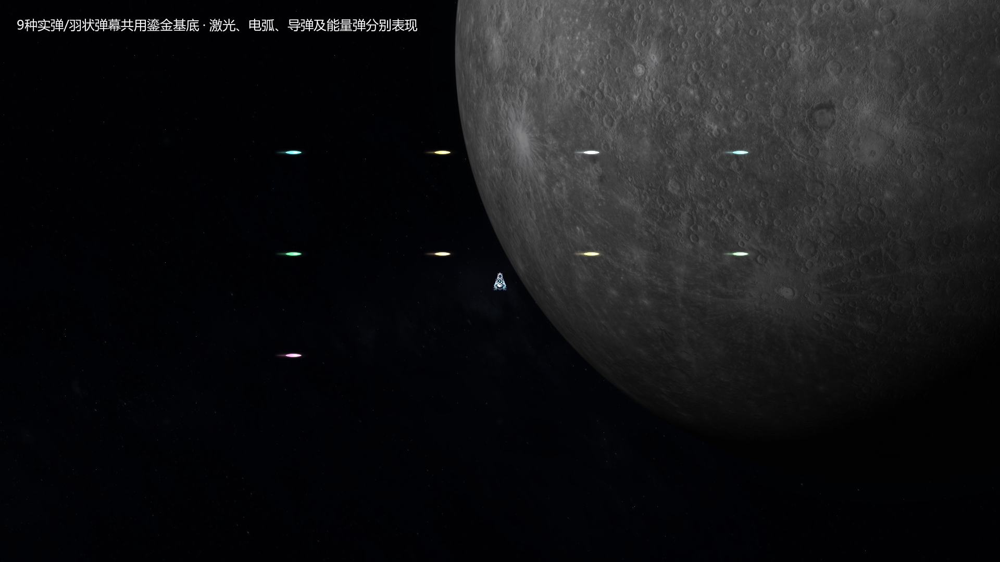
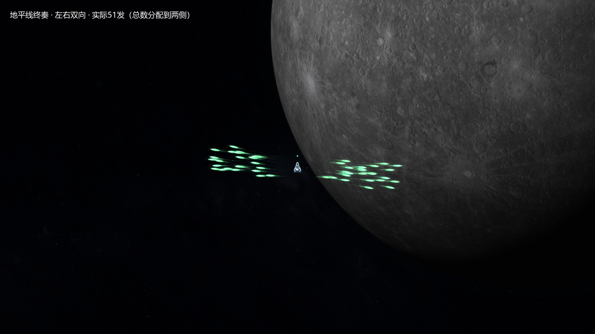
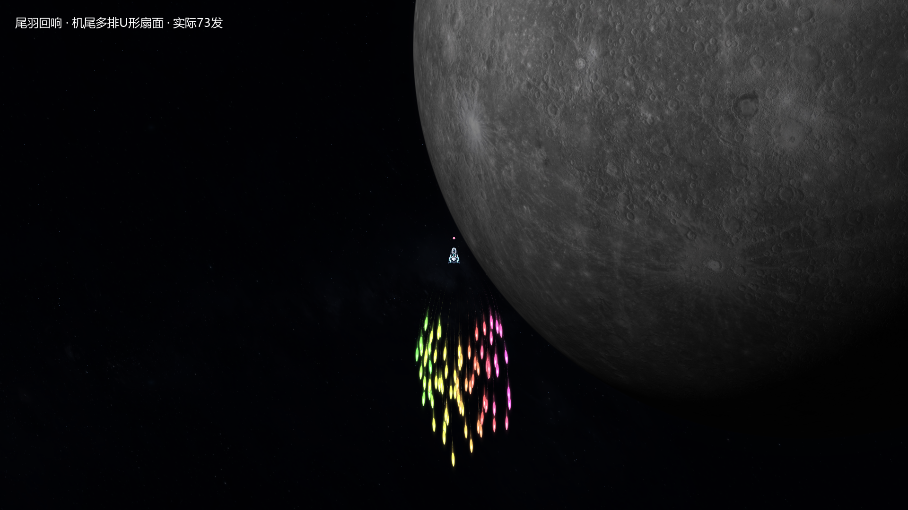

# V23：分类弹体、独立喷射与方向武器

2026-11-07，`0.23.0-hull-patterns`，开发分支 `codex/v23-directional-weapons`。

本版按用户连续补充落地：同类武器统一质感；每颗实体弹有自己的喷射时差、初速、质量和侧向受力；地平线向两翼发射，新增尾羽回响向后发射。子弹在有效射程内保持完整，达到射程后再缩小、减光、收拢尾迹并消失。

## 参考片段与制作判断

参考为本地 `E:/安泊尔57天王.mp4`，源文件1818×1080、30帧/秒。

| 片段 | 画面观察 | 本项目采用的规则 |
| --- | --- | --- |
| 4:05—4:20，尤其4:18后 | 金色弹群展开、弯转，后续弹群叠出羽状弧面，弹头和细尾迹同时可辨 | 发射结构决定总体包络，每颗弹体独立推进，尾迹采样真实路径 |
| 4:50—5:10，约4:57—5:05商店右侧 | 静态试射背景上能观察完整亮芯、远端小光点和消失过程，前向扇形最清楚 | 以有效射程触发退场，飞行途中不按弹龄提前缩小 |
| 10:00—10:20，特别10:01—10:03 | 机尾彩色弹群具有连续多排、两侧抬起、中间更深的U形包络；绿黄与粉紫两翼有明显区分 | 尾羽从后方打开，各弹丸以不同惯性转向机尾方向，形成多排彩色羽流 |

商店试射采用倾斜透视，屏幕尺寸也受到远近影响。约5:00.7—5:02.2的远端金色弹群可见持续缩小的收尾，作为约1.5秒退场参数的制作参考。它是收尾观察窗口，不能当作某颗弹丸完整寿命的逐帧测量。重叠弹群会使自动颜色跟踪交换目标，因此未把自动跟踪的总时长当作定值。

“完整飞到武器射程，再开始衰减”是用户确认的项目规则。录像支持这一画面表现，本文不声称已获知源游戏代码或其精确射程参数。

## 按类别统一

实弹/羽状弹幕采用用户选定的鎏金螺旋阵作为基础：发光叶状弹头、彩色边缘、柔和局部光晕和细尾迹。共9种：脉冲机炮、星砂霰弹、苍穹轨炮、星针狙击器、地平线终奏、终压攻城铳、鎏金螺旋阵、虹织十字炮、尾羽回响。

激光保留束芯与能量鞘；电弧保留分支连接；导弹保留实体弹体与推进外观；新星与星冕保留各自的能量弹、环绕形态。视觉类别与四项主属性分别管理，例如鎏金仍由能量属性加弹，不借美术统一偷偷改变属性来源。

## 每颗弹丸独立运动

12种实体弹武器共用独立状态，光束和电弧继续按瞬时射线、分支命中处理。每颗实体弹以装备UID、触发序号和弹丸序号生成可复现的参数：

- 初始偏角、出膛位置与0—32毫秒的个体喷射时差。
- 不同质量、初速、摆动相位、频率、侧向推力及阻尼。
- 按自身速度与受力积分位置，碰撞沿这条真实路径进行扫掠。
- 多排弹丸保留总体发射方向，个体可拉开距离、弯转、错位；没有共享刚体队列或每帧随机跳动。

地平线先以较低初速喷出，再各自推进加速；尾羽两翼先打开，随后以不同惯性转向后方。导弹有各自的追踪响应，星冕有各自的半径、相位与角速度，原有螺旋和编织轨迹仍参与运动。轨迹采样、渐隐与宽度收敛共同形成残余尾迹；尾迹不再绘成亮度一致的长直尺。

光晕始终保留。地平线采用绿色弹头，强调局部柔光和清楚的弹芯，远端尾迹逐渐变细、变暗。所有动画以模拟时间推进，暂停时停止。

## 两种方向武器

| 武器 | 实际发射形式 | 保留或新增内容 |
| --- | --- | --- |
| 地平线终奏 | 沿机身左右两翼喷射，多列错时，个体摆动与加速；总数分到两侧，奇数额外弹逐轮交替 | 原ID、低音钢琴、单发195伤害、36穿透、45爆破、8轮充能保留；基础总弹数由1改为2 |
| 尾羽回响 | 机尾多排U形扇面，绿黄左翼、橙黄中央、粉紫右翼；个体速度和转向响应不同 | 新武器，实弹属性、基础24发、1轮充能、占2格；固定拨弦弦乐音色 |

方向相对于实际机身朝向。自动瞄准模式下方向武器保持当前机身方向；随移动和固定朝上模式分别遵循对应设置。射程预览使用相同的基础发射几何，实战个体偏差在此包络内自然形成。

属性40、Lv.4的受控样本：地平线实际51发，尾羽实际73发。属性、品质和强化仍按V22统一公式结算，每排弹丸不会额外重复播放声音。

## 有效射程与退场

直射、曲射实体弹以自身实际路径累计距离。有效射程由修改后的弹速×飞行时长计算，限制在120—2400游戏单位；加速弹达到同一距离阈值更早，低速弹更晚。跨越阈值的一帧会把有效扫掠截在准确边界。

射程内尺寸为完整基准值。到达边界后进入1.5秒视觉退场：速度受到阻尼，弹头缩小，光晕减弱，尾迹变细并收拢，最后移除。退场阶段不继续造成伤害、穿透、追踪取敌或触发爆破。环绕弹按原有驻留时长退出轨道后退场。有效弹丸不会仅因离开镜头而被误删；渲染仍按视野裁切，实际弹体池上限4096。

原生专项样本使用350单位射程、500单位/秒的明确测试弹：0.6秒仍保持完整；0.7秒到边界；1.05、1.45、1.95秒逐渐缩小；2.25秒已移除。它用于看清退场，不是把所有武器的射程改为350。

[7秒原生演示](video-v23/directional-flight-preview.mp4)依次展示两翼发射、机尾羽流和这组退场样本。采用受控单次触发、属性40、Lv.4、无敌/静音条件；不代表自然成长获得配装或跳过正常充能规则。

## 音乐、验证与入口

现役16种武器，128份乐器样本。新增尾羽的8份拨弦弦乐由项目已有授权GeneralUser GS音色库离线渲染；原120份样本SHA256保持一致。音序器仍为3轨×8格、每格0.125秒、一轮1秒；固定音色、同种武器不同实例重奏、充能与发声分离均保留。

验证及原始结果见 [data-v23/SUMMARY.json](data-v23/SUMMARY.json)。包括16武器属性成长、真实方向命中、12类独立速度与曲线路径、可复现种子、30/120Hz轨迹差异、射程截断、射程外零伤害、GPU尺寸与光晕提交、原生动画和固定声音回归。另有不录屏的600敌机、8武器受控短时负载检查；不以短时样本宣称持续帧率或真人难度通过。

600近场敌机、8把Lv.4武器的压力样本中，帧耗时中位19.47毫秒、95分位27.66毫秒、峰值114.99毫秒，实际弹体峰值439、普通敌弹0、无弹池积压。仍存在突发帧峰，需要继续优化；该样本为固定高耐久敌机与受控时钟，不等于正常航线的持续帧率。

主要入口：`weapon_visuals.gd`管理分类基底、个体参数和受力；`weapon_emission.gd`管理两翼/机尾包络；`main.gd`管理实际飞行、命中及射程终止；`weapon_render.gd`与`weapon_body.gdshader`管理弹头、柔光与渐隐曲线尾迹。

本轮修改前备份：`codex/backup-20261107-before-directional-weapons`（`0c9f65e`）。独立喷射改动前备份：`codex/backup-20261107-before-individual-bullet-motion`（`6516327`）。两者均已上传并核验SHA。
