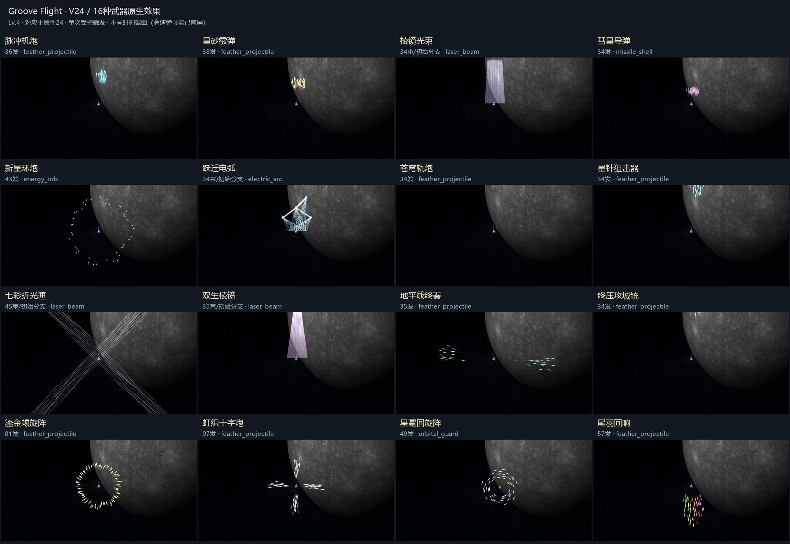

# V24：全部武器的独立运动与分类特效

武器与乐器的长期对照、原声试听和同步维护约定见[武器特效与音频对应表](WEAPON_VFX_AUDIO_REFERENCE.md)。本页记录V24专项实现。

2026-11-08，`0.24.0-independent-feather-plumes`，开发分支 `codex/v24-prism-feather-motion`。

本版检查全部16种现役武器，并补齐环形、环绕、四向羽流及光学武器的个体表现。13种实体弹各自运动，3种光束/电弧武器保持射线或分支形式。同类共享质感，各武器用发射包络、推进和转向形成区别。原有地平线两翼喷流、尾羽后射U形弹列和射程后退场规则继续有效，细节见[V23独立喷射](V23_INDIVIDUAL_WEAPON_FLIGHT.md)。

## 全部16种武器

| 武器 | 分类与实际运动 |
| --- | --- |
| 脉冲机炮 | 羽状实弹，错时出膛、独立初速与横向摆动 |
| 星砂霰弹 | 相同羽状质感，扇面内各弹速度、质量和偏角不同 |
| 棱镜光束 | 直线束芯与能量鞘；各束有轻微方向、宽度、相位和闪光时长差异 |
| 彗星导弹 | 导弹实体、推进尾焰，各自追踪响应与受力路径 |
| 新星环炮 | 全周能量珠；约束初始偏角以保留圆周覆盖，各颗以不同速率弯转 |
| 跃迁电弧 | 目标之间的连锁电流，每段保留自己的稳定相位、宽度和闪光时长 |
| 苍穹轨炮 | 高速贯穿羽弹，独立初速和细微受力，尾迹来自实际路径 |
| 星针狙击器 | 集中发射的羽弹，各弹独立质量与推进，保持狙击主方向 |
| 七彩折光匣 | 四斜向多排彩色U形羽流，整体轻摆，弹头持续飞行、独立弯转，实际抵达后命中 |
| 双生棱镜 | 双重光束结构，各束独立方向微差、宽度、流光相位与闪光时长 |
| 地平线终奏 | 机身左右两翼，低初速喷出后各自加速，保留柔光和真实弯曲尾迹 |
| 终压攻城铳 | 重型贯穿羽弹，独立喷射时差、惯性与实际扫掠 |
| 鎏金螺旋阵 | 羽状基底，独立参数叠加螺旋弯转，保留原先的整体展开形式 |
| 虹织十字炮 | 四向编织羽弹，实际运动叠加独立侧向受力，各颗有不同相位 |
| 星冕回旋阵 | 分层环绕实体，各自角速度、呼吸半径和跟随惯性 |
| 尾羽回响 | 后射多排彩色U形羽流，两翼展开后逐渐转向机尾，各弹独立速度与转向 |

十种羽状武器继续共享用户选定的鎏金弹头、柔光和细尾迹。七彩折光匣按用户最新反馈加入这一羽状类别，共10种。导弹、能量珠、环绕、激光、电弧保持相应形态。这些是用于手感的二维惯性与光学表现，不声称还原参考游戏的内部代码或进行真实电磁仿真。

总览为每种武器Lv.4、对应主属性24的受控单次触发截图；电弧放置固定高耐久目标以展示连锁。截图时刻不同，不用于比较射速或伤害。部分高速弹已离开镜头，未显示的弹头不代表少发。

## 环形与环绕

新星环炮保持完整圆周包络，每颗能量弹保留自己的喷射时差、速度、质量和摆动，另有独立弯转速率。初始角度扰动按相邻弹的角间隔约束，避免高弹数时整圈塌向同一方向。尾迹更细、半透明，保留能量珠的发光核心。

星冕回旋阵不再整圈紧贴玩家位置瞬移。每颗拥有独立环绕中心，以自身响应速度跟随玩家，半径轻微呼吸、角速度缓慢变化；玩家移动时，轨道和实际残余路径自然错开。驻留时长、碰撞扫掠与退出后的退场仍沿用原规则。测试同时修复了等待出膛时重设位置造成的首帧跳跃。

## 七彩折光匣：四斜向摇摆羽流

用户最新反馈明确要求与尾羽回响一样的持续飞行质感，否定中间制作的短暂激光束。当前七彩折光匣已采用羽状实体弹，保留原四个斜向，但每个方向改为多排U形喷流；每颗有真实位置、速度、质量、出膛时差、受力和碰撞记录，伤害等待实际抵达目标。

四个方向分别有柔和的导向摆动，组内各颗保留自己的相位、初速和侧向受力。展开的两翼以惯性回收，形成错位、弯转的彩色羽流，不再是笔直且同时闪灭的一束。弹头、局部柔光与尾迹沿用尾羽/鎏金基底，尾迹采样实际运动路径。

基础弹数、对应主属性、品质与强化加弹、单发伤害、穿透和充能不变，额外弹数分配到四个方向，不额外乘四。分裂与爆破仍由实际命中触发。有效射程内弹头保持完整，到射程末端才缩小、减光并收拢尾迹；射程外不继续造成伤害。测试覆盖延迟抵达、两次穿透、真实分裂子弹和完整退场。

普通激光仍是直束，各束加入轻微方向、宽度和闪光差异；电弧保持目标连锁，每段有自己的稳定相位，避免因其他特效消失突然换形。OpenGL与Forward+分别验证实际羽弹的完整提交。

## 保留的底层规则

- 实体弹在有效射程内保持完整尺寸；超过射程后才进入1.5秒视觉退场，缩小、减光、收拢尾迹，且不继续造成伤害。环绕弹按驻留时间退出后退场。
- 弹数继续通过对应主属性、品质、强化与原有改件统一计算。总弹数分配到实际方向和弹排；未增加武器种类或改变基础伤害、充能门槛。
- 音序器3轨×8格，每格0.125秒，一轮1秒。扫到起始格播放一次固定乐器声音，同种武器不同UID可重奏。额外弹排和曲线不新增声音，128份音频逐份核对SHA256保持不变。
- 敌机出生、疏散、包围、碰撞、模型与护盾规则沿用此前版本，见[敌群机制](ENEMY_FORMATIONS_AND_ENCIRCLEMENT.md)。本版没有重做敌机算法或替换音源。

## 实机预览与验证

[8秒静音原生预览](video-v24/all-weapon-motion-preview.mp4)：依次展示四斜向摇摆的七彩折光匣、新星环炮和移动战机周围的星冕。1920×1080、24帧/秒、Lv.4、对应主属性40；新星与折光为明确的受控重复触发，方便观察多组羽流包络与独立运动，正常游戏的充能没有加快。

结果和导出名单见[data-v24/SUMMARY.json](data-v24/SUMMARY.json)。覆盖16种武器、13种实体弹、圆周覆盖、环绕惯性、四向摇摆羽流、延迟抵达与穿透、GPU提交、原生截图，以及属性弹数、射程、固定声音、同种重奏、音序和作曲回归。Forward+与OpenGL分别检查。它们是明确条件的回归与展示，未代替真人试听、平衡验收或八星完整航线测试。

独立高密度测试使用600架高耐久敌机、8把Lv.4武器、四项主属性24和受控时钟，不录屏、不与其他测试并行。帧耗时中位10.64毫秒、95分位14.36毫秒、峰值74.94毫秒，实际弹体峰值453、无弹池积压。偶发耗时峰值仍需后续优化，不把短测换算成持续帧率保证。

本轮之前的V23为`bfedd71`。修改前已上传并核验备份`codex/backup-20261108-before-all-weapon-pass`，SHA为`045359fdaf3fa9f737687a0d991e87e02b582e7b`。备份保留了当时Godot导入UID更新；实现继续在独立V24开发分支进行。

用户最新折光羽弹调整前另已上传并核验备份`codex/backup-20261108-before-prism-feathers`，SHA为`ad14a6892b0c2fb2b7bdd81215d50ece7dd4f710`。该备份包含被用户随后否定的中间激光方案，仅作历史回退；当前开发分支为`codex/v24-prism-feather-motion`。
