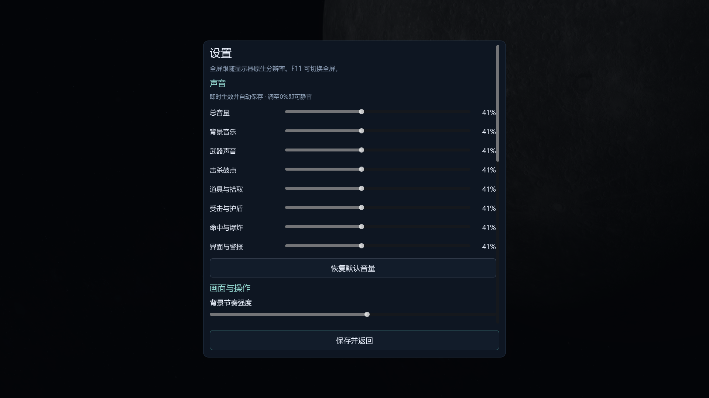

# V26：分类音量与反馈声音

2026-11-08，`0.26.0-category-audio`。从主页、暂停页或游戏内导航进入“设置”，顶部“声音”区域可调节下列8项。调节即时生效、自动保存；0%为完整静音，可一键恢复默认。

| 控制项 | 对应声音 |
| --- | --- |
| 总音量 | 全部游戏声音 |
| 背景音乐 | 主页、都市、机库、星图和关卡/商店背景音乐 |
| 武器声音 | 战斗钢琴/提琴/竖琴、图鉴试听、商店试射、自由作曲及其单音试听 |
| 击杀鼓点 | 击败敌人后的低沉鼓声、连续击杀短鼓列 |
| 道具与拾取 | 金币、补给与掉落物的拾取反馈 |
| 受击与护盾 | 玩家受击、碰撞与护盾反馈 |
| 命中与爆炸 | 武器命中敌人、爆炸等战斗反馈 |
| 界面与警报 | 操作、奖励、敌群出现和特殊敌人提示 |

背景音乐与武器完全分开，关闭背景音乐仍可听武器；改变音量不重新生成整段PCM、不替换当前乐谱、不重置扫描位置、不改变伤害和弹数。暂停时调整音量也不会推进音序。商店试射与作曲试听均遵循同一武器音量。

旧配置会迁移一次：此前“乐曲总线”同时乘在武器声上，因此迁移后武器音量取旧武器值×旧乐曲值；旧总音效值分别带入5类反馈。迁移只保留原先的声音级别，不重置其他设置。独立类别在保存后不再互相联动。

新安装的默认值为总音量75%、背景音乐75%、武器25.5%、各反馈55%；界面按整数百分比显示。各类别还会与总音量相乘。使用既有配置时，以迁移后的值为准。

720p可滚动设置页见[较小窗口截图](screenshots/v26-audio-1280.png)。音量行都保留百分比、键盘可操作的滑块和说明。

## 用户提供的反馈参考

用户再次指定本地《音频资源.mp4》，52.706秒、48kHz双声道。其SHA256与已入库的`gameplay_feedback_audio`一致，原片与完整音轨、波形和频谱均已保留，无须重复覆盖入库。

- 击杀：低沉且连续的鼓点，保留死亡回调的立即反馈与125毫秒短鼓列。
- 拾取：清脆的短音，独立保留拾取播放池。
- 受击护盾：用户指出28秒附近；画面在约28.5秒出现受击保护，随后橙色保护环展开。以对应瞬态及完整衰减核对，不直接从整数28秒硬切。

录屏是混合声音，滤波得到的事件片段不能称为原游戏的独立音轨。来源、截段和处理以音频资料库中的当前分析记录为准。

## 验证与实现

`scripts/audio_controls.gd`统一负责配置、旧值迁移与音量路由；`main.gd`统一设置播放路径；`event_mixer.gd`保留独立反馈播放池；设置页通过同一入口更新并保存。0%通过实际音频通道静音实现，不只是把滑块数字改成0。

专项检查覆盖真实滑块、旧配置保存往返、背景/武器/试听分类、各反馈路径，以及在原生模式捕获最终立体声输出：逐类验证100%、25%和0%，并检查关闭背景时正在播放的武器仍有输出。截图与捕获是受控检查；未代表完整航线或主观混音验收。

本轮修改前备份：`codex/backup-20261108-before-audio-controls`，SHA `0698dcf8b9025585143c514fa444910c2b74d0dd`。
