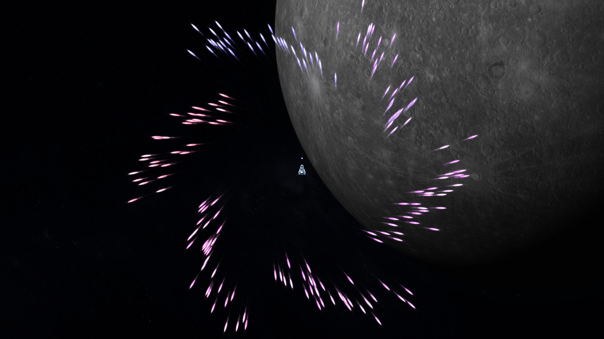

# V41 西风与同轨万花筒

2026-11-09，`0.41.0-westwind-kaleidoscope`。V40已检查上传，随后修改前备份 `fa855416abb9f7976ee1e64a3958cc2b1d038e50` 已上传并核验；开发分支 `codex/v41-westwind-kaleidoscope`。

## 参考观察与本版实现

参考用户提供的《安泊尔57天王.mp4》4:05–4:15，以及《屏幕录制 2026-11-01 234745.mp4》3:26–3:30（约3:30后出现结算遮挡）。前者可见弹列前段保持发射方向，后段逐渐向屏幕右方汇流；后者可见多个向外展开的旋转弧形弹列和嵌套花瓣。抽帧保存在本地work目录，不随项目发布。

画面不能证明参考游戏的源码、道具参数或精确加速度。本版按用户明确的“西风”和“同轨同步”设计自己的受力规则，未提取参考游戏模型、纹理或音源。

## 西风（道具 `westwind`）

稀有改装，1格，基础价格23，进入正常道具池；实战价格沿用V40星球/波次倍率。对全舰**自由飞行的实体弹**施加世界坐标向右的气流，包含羽弹、导弹和能量珠。绑定战机的环绕体、真激光、闪电链保持原模组。

每颗弹体走到自身有效里程约60%后开始逐渐受风，到约92%趋于全强；个体有小幅错峰和质量差异。最大基础右向加速度2100×气流强度/质量，叠加/精炼强度封顶3，实际速度上限也受原弹速与3000限制。进入强风时原有导向力平滑让位，避免僵硬瞬间折角。

气流改变真实速度、位置、扫掠碰撞和残余路径。前半段不变，不增加弹数、伤害乘数或额外声音；不会在有效射程前缩小。按实际曲线路程到射程后进入既有1.5秒无伤害退场，保留受风后的惯性再衰减，不额外延长伤害距离。

50Hz检查中，脉冲末段速度从约(-51,-822)变为(633,-824)，总速度确实增加；50Hz/100Hz终点差约3.6世界单位。这是本版受控数值，不是从视频反推的原游戏参数。

## 万花筒（武器 `kaleidoscope`）

| 项目 | 实现 |
| --- | --- |
| 类型 | 实弹/羽状实体弹，3格，史诗，基础价格48；正常第四波起商店可抽取 |
| 基础战斗参数 | 6轮充能（9秒）；44基础弹、单发6伤害、2次穿透、基速780，基础有效行程2300（射程改装沿用2400上限） |
| 形态 | 六瓣旋转甩射；先有切向速度，径向速度逐渐接管，形成向外展开的弧形花瓣。分支分配原有弹数，数量随共享属性/品质/精炼策略增长 |
| 个体与色彩 | 各弹独立时差、质量、初速及实际受力；约0–0.493秒展开。自身为珠光紫/粉/淡白羽弹，柔光及真实细曲线残迹；52×15轮廓，保留同类材质 |
| 声音 | 已有授权采样库的珠光高音三角钢琴，G5/MIDI79；新增8份作曲音高、4份独立半秒演奏。真实齐射强→很强交替，9秒间隔，只响一次 |

**装备期间的同轨被动规则**：同音轨每件自由飞行实体武器，在它自己的实际发射时使用万花筒的旋转甩射形式。自身充能/属性/弹数/单发伤害/穿透/材质/颜色/声音保留；导弹仍有后续追踪。激光、电弧和绑定轨道体保持其原模组。移出该轨或卸下万花筒，后续新发射恢复原形式，已出膛的弹体保留其发射快照。

旋转相位取实际发射时刻和音轨，各轨有相位与方向差异；不是把同轨所有武器的发声时间强行改成一致。万花筒等候充能期间，同轨被动依然有效。多个万花筒不会凭空复制弹数或声音。

与西风叠加后，旋转甩出的花瓣在各自后段被气流拖向右方。实际规则在 `scripts/projectile_fields.gd`，接入既有发射、独立飞行、扫掠命中和退场路径；衍生弹仍遵守原深度及预算，并继承相应环境/发射规则。

## 验证与试玩入口

[同一齐射：左侧无西风，右侧有西风](video-v41/kaleidoscope-westwind.mp4)。这是192颗真实实体弹的受控原生展示，便于看密集形态，不代表初始配装或额外弹数奖励。

专项覆盖真实后段加速、前半段保持、帧步长一致性、射程/退场、1/8/64/256弹守恒、同轨/跨轨切换、真实到达伤害、激光/电弧/环绕隔离及六轮发声。全20武器回归覆盖实际首弹/声音、80份力度演奏和160份作曲音高；对比不可变V40提交，旧228WAV及19件基础参数和原生crowd DLL保持不变。

新增资源导入固定PCM16，图鉴与导出资源同波形；修复窗口缩放时底层UI刷新销毁图鉴的问题，保留选择及试听。当前[生产导出](data-v41/weapon-selection.json)、[覆盖/航线快照](data-v41/run-foundation.json)、[旧版保留核验](data-v41/asset-preservation.json)、[验证汇总](data-v41/SUMMARY.json)。

三条含新商品池的代表数值路线，每店模拟15秒，水星约5:09、地球5:39、海王星5:44，均实际击败Boss。它们不是全部构筑、困难难度或真人胜率保证；商店仍不限时。短片及专项检查也不认证持续60FPS或主观听感，后者留给实际试听。

图鉴可在“6轮充能”找到并试听万花筒；西风在正常改装道具池。原始三件初始武器、1.5秒音序器、0.5秒敌机步进、关卡节奏和独立音量控制保留。后续开发优先级见[模组方向](WEAPON_MODULE_ROADMAP.md)。
