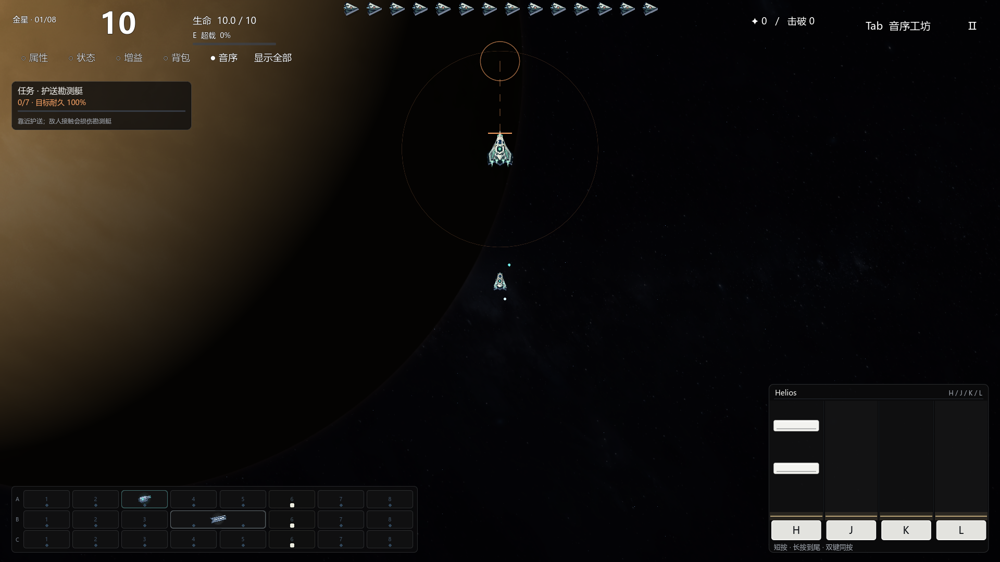
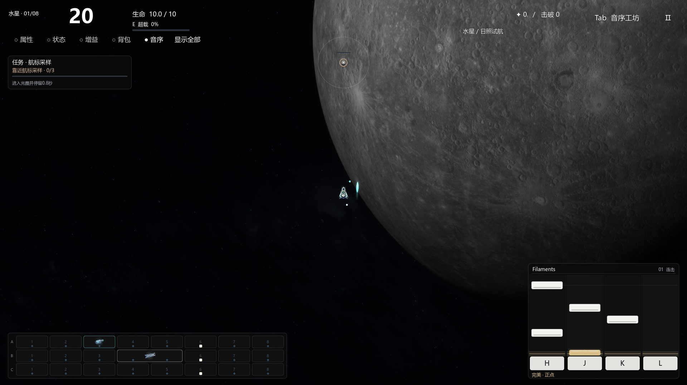

# V53：每颗星球的任务、歌曲与琴块

2026-11-11 · `0.53.0-planet-scores` · `codex/planet-music-identities`。
修改前远程备份：`codex/backup-20261111-before-planet-music`，
`6a91158058c12d063c7bf5f6fef971cd1f43cc28`，已上传并核对远程SHA。

用户明确选择“任务目标变化：护送、防守、摧毁据点等”。本版让普通波次就产生不同操作目标，保留原星球背景与Boss。七波时间仍为20/20/20/27/27/33/40秒，商店不限时；原5–6分钟是典型目标，任务完成速度和购物会影响实际时长，没有强制倒计时结束全关。

## 已接入的八种任务

| 星球 | 实际目标 | 玩家需要做什么 |
| --- | --- | --- |
| 水星 | 航标采样 | 三个航标，第1/3/5波依次开放；进入110范围停留0.8战斗秒，离开逐渐回落。 |
| 金星 | 护送勘测艇 | 七个逐波航点；玩家在290范围内，艇才以85单位/秒前进。部分敌人改攻艇体，必须随艇清路。 |
| 地球 | 守住通讯站 | 固定站体守七个普通波次；约60%普通敌机以站体为目标，其余压迫玩家。站毁立即失败。 |
| 火星 | 拔除攻城据点 | 三座真实可受击据点，第1/3/5波开放；正常武器弹体/激光/电链命中扣耐久，漏按不产生新伤害。 |
| 木星 | 风暴追猎 | 三艘标记舰；目标使用原个体运动/避让系统绕行，玩家须追上并正常击破。 |
| 土星 | 星环航门 | 第1/3/5/7波开放四道门；沿箭头从入口侧穿过±145宽的中部，反穿或绕到外侧不计。 |
| 天王星 | 冰轴共振 | 三个晶体；在230范围内完成四次成功琴块手势激活一个，失败/圈外输入不能积攒。 |
| 海王星 | 终潮远征 | 第1/3/5/7波依次开放采样→护送→破核→共振，组合前面机制。 |

所有普通战役必须**任务完成且Boss击败**才通关。Boss先死时可继续完成余下目标，顶部显示“撤离”。自由作曲试飞/独立试听不强加任务。任务HUD显示当前完成量、目标耐久/共振数和规则；目标离屏时出现方向指针，星图也显示本关任务与歌曲。

护送艇/通讯站180耐久，每次实际扫掠接触扣0.8，普通波间修复12，站毁/艇毁即时失败。撞击敌机被消费但不奖励假击杀/金币。敌军出生和展开避开友方目标；普通敌人仍不发射子弹。防守结算按波次去重，不会重复计数。

据点基础500耐久，追猎舰650，每完成一个目标后+20%，高压难度再×1.18；据点半径52、不会追人。1.2秒红色预警且出生净空通过后才出现，目标UID/剩余耐久跨商店和波次清理保留。零接触伤害不会误给玩家护盾无敌。

`planet_mission.gd`保存本局任务，`mission_hud.gd`负责显示，`main.gd`接实际更新/接触/过波/胜负。普通连续运动仍每0.25秒规划；`contact_swarm.gd`只接受可选任务目标，并为大据点扩展保守查询范围。原生数值内核、DLL、运动向量和普通机净空不改；原生与脚本路径均核对大据点扫掠不重叠。

## 八首完整歌曲与试听

均为Scott Buckley作品，CC BY4.0。下表链接直接指向工程实际播放的完整OGG；官方来源、下载URL、SHA256、获取日期及转换说明在[audio/PLANET_MUSIC.json](../audio/PLANET_MUSIC.json)。原Filaments未改字节，新增七首整曲转为44100Hz立体声Vorbis，不裁段、不变速、不移调。设置、[总署名](../CREDITS.md)和[逐曲授权](../audio/authorized/scott_buckley/planets/LICENSE.md)保留署名及来源；后续打包须携带。

| 星球 | 实际曲目试听 | 完整长度 | 候选点：短按/长按/双键 |
| --- | --- | ---: | ---: |
| 水星 | [Filaments](../audio/authorized/scott_buckley/filaments.ogg) | 339.88秒 | 435 / 108 / 39 |
| 金星 | [Helios](../audio/authorized/scott_buckley/planets/helios.ogg) | 358.09秒 | 331 / 102 / 4 |
| 地球 | [Reverie](../audio/authorized/scott_buckley/planets/reverie.ogg) | 223.67秒 | 362 / 54 / 37 |
| 火星 | [Legionnaire (Original)](../audio/authorized/scott_buckley/planets/legionnaire.ogg) | 184.00秒 | 260 / 42 / 41 |
| 木星 | [Titan](../audio/authorized/scott_buckley/planets/titan.ogg) | 175.76秒 | 184 / 50 / 5 |
| 土星 | [Cassini](../audio/authorized/scott_buckley/planets/cassini.ogg) | 290.50秒 | 495 / 118 / 4 |
| 天王星 | [Luminance](../audio/authorized/scott_buckley/planets/luminance.ogg) | 293.27秒 | 453 / 65 / 3 |
| 海王星 | [Omega](../audio/authorized/scott_buckley/planets/omega.ogg) | 245.22秒 | 219 / 73 / 3 |

以上是完整歌曲的**候选点数**，实际落下的琴块取决于武器原充能资格映射，不会无条件把整首全部候选点都刷出。菜单仍使用Filaments，只有新开对应星球战役切换该曲；调音量、打开/关闭设置、暂停/继续、购物不会重头播放。每首按实际长度独立循环，与原生156秒PCM的12+144秒循环分别计数。短曲在较长战役中会循环，不声称全部歌曲都长于关卡。

## 谱面与琴块

`tools/build_planet_charts.py`以11025Hz分析、1024窗/256跳步计算频谱通量，建立具有局部节拍连续性的路径，邻近可闻起音则吸附，强拍可用半拍分割；静段保留受控节拍候选，避免获得资格后长时间无点可用。每星球有重复指法动机，强起音结合频谱音区，弱音限制跳列；长按位于持续声体/乐句收束，双键偏重强起音。天王星按Luminance官方描述使用七拍分组，其他为游戏四拍分组，不宣称精确调号/拍号识别。

谱面并非原曲的精确MIDI或人工扒谱；部分柔和曲目可闻瞬态锚点较少，节拍路径/重复动机占比更高。自动估算BPM存在倍速/半速歧义，不能当成乐谱速度标注。每首实际统计在[分析快照](../audio/charts/planets/ANALYSIS.json)，后续可逐句人工修订。没有宣称真人听感/节奏准确度已验收。

H/J/K/L独立于A/B/C装备轨。头部有效±75ms、完美±35ms；长按0.30–0.65秒、尾端75ms宽容；双键须重叠且间隔≤60ms。失败不新增起音或齐射，原充能资格不退还。相同候选点可共用操作，各装备UID仍各自一声、保留原轨声像。按住或echo不能授权下一块；键盘、触摸、鼠标全局松开和失焦清理保持。

白色琴块头增加顶面反光、暗部与边线；长按用细双导轨/尾端标记，强乐句有淡引导线，命中出现克制微光与少量碎光，底部显示早/晚毫秒、正点、失败与连击。画面和点击共用TOP/下落时间。没有新增命中音或成功伤害加成。

设置→声音下方→**节拍校准**：±150ms，每步5ms，默认0。正值让琴块和成功发射稍晚，负值稍早；修改保存并清理旧待判输入，继续只预测新点，不跳播音乐、不自动开火、不扩大判定。该滑块不改变原1.5秒充能相位或音源速度。没有测量用户实际声卡/显示器延迟；需要用真实耳机与按键试听校准。

## 验证、保留项与交接

[当前核对快照](data-v53/SUMMARY.json)归档任务、谱面、输入、实时运输和Forward+结果。任务检查包括跨波保留/站毁失败/Boss双门、顺逆穿门、圈内成功输入、防出生重叠、大据点原生/脚本扫掠；八首真实流加载、各自歌曲/PCM回卷、暂停/设置/音量连续性另有实跑。图像覆盖八星任务、1920与1280/120%文字、命中和校准。测试不代表完整战役平衡或持续60FPS认证。

24件武器的目录、原288份现役WAV及全部存档WAV、声音力度/总线/声像、1.5秒资格、原弹数/伤害/成长/轨迹/材质、Boss评分、原背景和原生DLL与备份逐文件哈希核对。任务目标产生的路线改变为本版授权变化，不把它描述为“所有敌人行为未改”。

从根目录`Play.cmd`运行当前工程。历史V49 ZIP与用户PPT未改写，也未重新打包Demo。后续正式导出由当前版本生成独立目录，并收集全部歌曲、谱面与署名。开发和声音规则仍以[持续维护对应表](WEAPON_VFX_AUDIO_REFERENCE.md)为统一入口。

