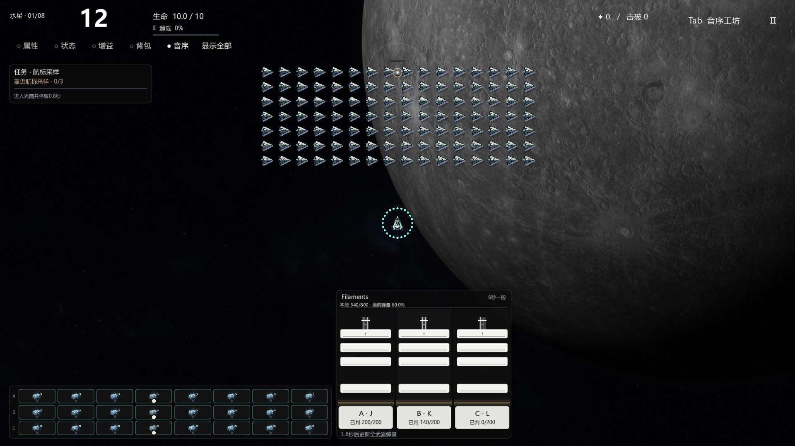

# V55 三轨合并成绩决定全武器弹量

2026-11-13 · `0.55.0-combined-rhythm-score` · `codex/combined-rhythm-score`。
修改前备份分支`codex/backup-20261113-before-combined-rhythm-score`，提交`bab8df876a1440278abeb65ba5723900b7835fe5`，已上传并核对远程SHA。

用户将V54的三轨分别结算改为三轨合并：

**下一段6秒的统一弹量比例 = 本段A、B、C实际得分之和 ÷ 本段A、B、C理论满分之和。**

不是三个百分比的算术平均。比如A轨100/100、B轨0/300、C轨0/0，结果为100/400＝25%，而不是50%或33.3%。空轨没有琴块就不添加满分分母；整段三轨都没有可计分琴块时，沿用上一段统一比例。

## 当前保留的规则

- J/K/L仍对应A/B/C，三列各自判定、支持短按与长按；面板仍紧挨音序器右侧并底部对齐，窄屏不足时放在右上方。
- 开局0至6秒全武器弹量100%；每段成绩影响下一段，当前失误不立即取消本发。
- 完美100分、普通成功70分、漏按/长按中断0分。有效±75ms、完美±35ms和尾端宽容保持。
- 原1.5秒音序充能及映射后的音乐点自动齐射保持；单弹伤害、速度、射程、折射/传导不受评分额外缩放。
- 全部轨道的最终弹数使用同一个比例。仍在属性、品质、精炼、驾驶员、超载之后计算，并保留按武器UID/来源轨分别累计的小数余量。
- 0%时全部武器没有新弹体、炮口或起音，琴块继续供恢复成绩；非零齐射一声原动态WAV，已有弹体和尾音继续保留。
- 暂停、商店、设置、编排与图鉴保持战斗时钟；换装、切波保留成绩状态，新局恢复100%。边界按`floor((琴块尾端+75ms)/6)`归段，保证原判定宽容。

## 实现与呈现

`scripts/rhythm_score.gd`只保存一个生效`ratio`；`advance()`先把三个轨的实际分、满分、琴块数量相加，再除一次。`current(track)`继续提供各轨明细，新增`total()`提供当前段总分。各轨明细不再形成独立的火力倍率。

`main.gd`为任何来源轨读取同一个`score.ratio`，再走已有弹量和声音路径。琴块面板上方显示三轨合计分与全武器弹量比例，底部琴键显示各轨已判分；教学、流派选择说明与图鉴文案同步更新。

## 核验

[当前核对](data-v55/SUMMARY.json)记录不等量琴块的加权总分、空轨/空段、段边界、0%恢复、全24武器三轨实际弹数与声音、歌曲/PCM续播以及真实三键/鼠标/触点/布局检查。

八首完整歌曲及3487候选点、288份现役WAV、武器基础参数/弹道/材质、原生内核、八星任务与Boss均与修改前备份核对保留。没有重打包历史Demo或修改用户PPT、课程报告。测试不代表人工难度/听感或持续帧率验收。

