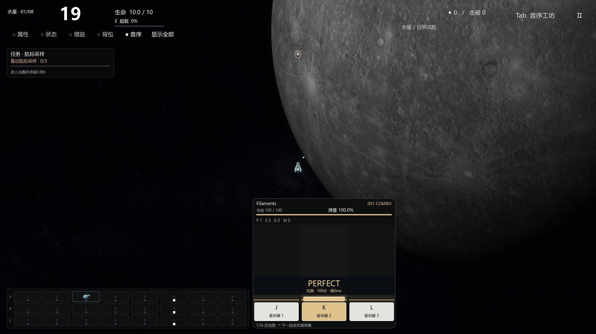

# V56 背景音乐主导的音游重构

2026-11-14 · `0.56.0-music-first` · `codex/music-first-rhythm`。
修改前远程备份：`codex/backup-20261114-before-music-first` / `2db4e1dfb21e0dc1ca3714f59a0acd755374d1af`，已上传并核验。

## 本轮落地

- **歌曲是主轴**：八星各自完整BGM与候选点保留；J/K/L三键按歌曲时间、起音/长按与固定交替指法生成谱面。空配装也出琴块，武器种类、格子、数量、充能或购物不改谱面。算法编排，不宣称人工精确扒谱。
- **四档判定**：Perfect／完美±35ms＝100；Excellent／优秀35–75ms＝80；Good／一般75–140ms＝40；超出±140ms、漏按或长按中断＝Miss／0。边界含等号。长按取头/释放更差时差；一直持有到尾端则按头判断，尾端140ms宽容。空击/echo不加分，每个琴块仅结算一次。
- **操作控制火力**：每6个战斗秒，三键实际总分÷三键总满分，控制下一段6秒全部武器的最终弹数/光束根数/电链根数。开局100%；允许0%，琴块不断供以便恢复；全空段沿用。按UID/来源轨累计不足一颗的余量，单弹伤害、射程、速度、折射/传导不额外乘评分。
- **去掉武器配音**：实时演奏器移除加载/播放实现；PCM只作无声时钟，武器/支援/底层乐器均不预混；旧单音/录音组入口不播放。旧音色图鉴改为武器弹道/充能图鉴，移除乐器分组、力度试听和自由作曲主入口。旧WAV只保留作历史来源归档，未来导出规则不再收录`audio/arsenal`与`audio/legacy`中的WAV/OGG。许可证保留；本轮不重打包历史Demo。
- **取消流派**：选星后直接出击，重试无需选流派；24种武器与适用道具不再按实弹/激光/电链过滤，支持自由混装，仍3武器+3道具并保留锁定刷新与品质时机。旧流派设置无效。开局脉冲A3、苍穹B4–B5以及10点实弹基础加成保留；不重新加入流萤。
- **音游界面**：深色面板、象牙琴键/音符、金色判定线和弹量条，增大可读落键区。显示歌曲、Combo、P/E/G/M计数、本段总分和当前弹量；四档独立颜色、大字判定、早晚毫秒、轻量粒子。保持音序器右侧与底部对齐，窄屏上移。
- **音乐优先**：不再因武器齐射压低BGM，原武器音量项移除，旧武器总线始终静音。独立反馈总线保留，音乐优先混音需玩家主动选择，原保存的音量不被自动覆盖。

## 时钟与兼容

三键不再与装备A/B/C一对一门控。`rhythm_gate.gd`的`notes`仅为歌曲输入，`salvos`单独记录原武器1.5秒/8格充能资格映射后的音乐齐射，避免换装改谱。短按/长按与不同键同时操作保留；本轮没有新增滑键、连打或敲击音效。

原生PCM156秒(12+144)仍作连续无声时钟；BGM完整歌曲独立循环，购物/暂停/设置/图鉴共同冻结，恢复不重播。校准±150ms仍有效。计分归段`floor((尾端+0.140)/6)`，保留完整判定宽容，不追改已生效弹量。新局100%，换装/切波保留已结算值。

敌人、Boss、八星任务、子弹独立运动与曲线尾迹、战场、模型、伤害/基础数量/成长/射程、原生C++/DLL未因本轮音游重构重做。旧作曲器源码、音色字段及`combat_doctrines.gd`兼容壳留在仓库，已退出正常游戏流程；不表示这些旧系统仍是现行玩法。

## 后续方向（尚未实现）

优先完善琴键手感、时延校准、节奏击键音/长按音、判定光效、震动与音乐段落反馈，再增加滑键、交替连打、复杂组合及人工编排难度。以歌曲可读性和操作反馈为标准，武器承担弹幕视觉与战斗结果，不再另奏乐器。

## 验证

[验证快照](data-v56/SUMMARY.json)含四档边界、长按/漏按、三键合计比例、小数弹量、24武器三轨实际弹数与零武器配音、八首谱面与配装解耦、统一商店、真实BGM/PCM循环与暂停续播，以及Forward+按键/鼠标/触点和布局。

测试不代表人工听感、谱面难度或持续帧率验收。历史PPT/Demo/私人课程报告不改。
