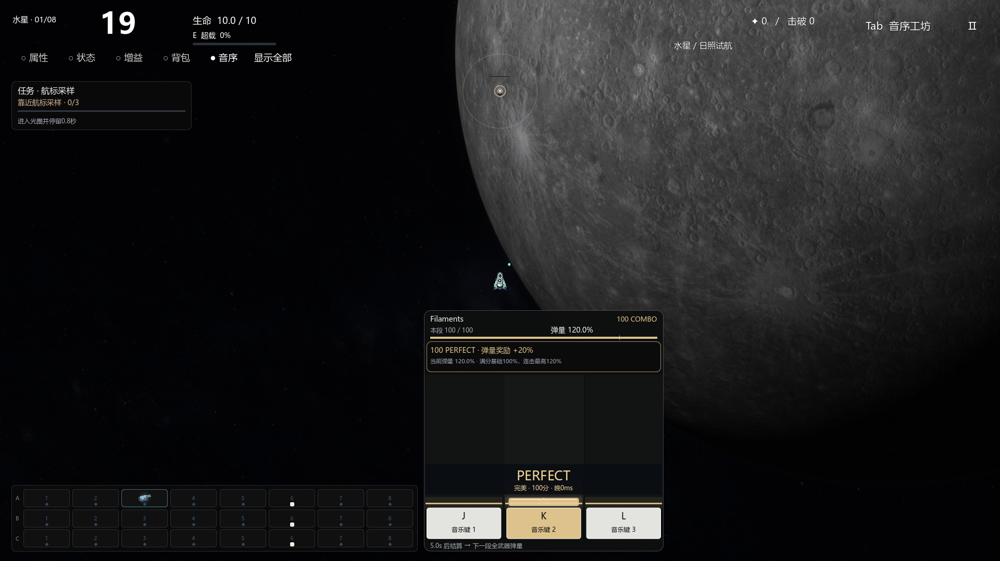
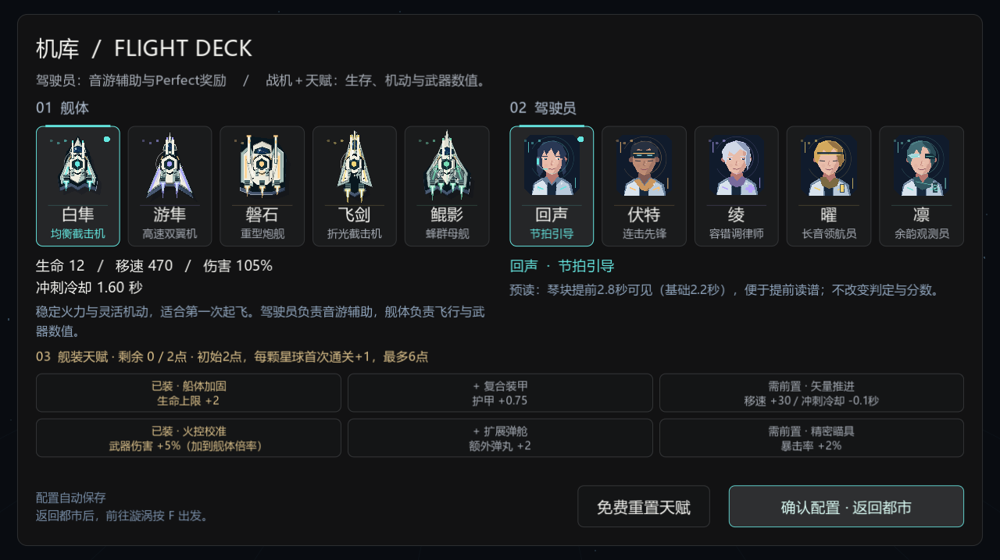

# V57 连续Perfect奖励、音游驾驶员与舰装天赋

2026-11-14 · `0.57.0-perfect-pilots` · `codex/perfect-rewards-pilots`。
修改前备份`codex/backup-20261114-before-perfect-pilots` / `8bc289aa7caf06b6c95a0abbf16918ac7907dfbd`已上传并核验。

## 两种连击

普通Combo记录完美／优秀／一般等所有成功，Miss／空击归零；10／25／50／100及之后每100连击显示提醒。**Perfect链单独累计**，普通驾驶员遇到任何非Perfect判定或空击归零，持键/echo不计新命中。

| 连续Perfect | 额外弹量奖励 |
| ---: | ---: |
| 10 | +5% |
| 25 | +10% |
| 50 | +15% |
| 100 | +20%，最高档 |

晋档当次立即生效，奖励取当前档不逐档叠加。基础弹量仍由上一段六秒三键总分/总满分决定，开局六秒**基础**100%。最终比例＝基础比例×(1＋当前连击奖励)，最多120%。例如80%×120%＝96%，100%×120%＝120%；0%依然不能开火，琴块持续以便恢复。奖励中断只移除奖励，不改已经结算的基础成绩。

数量在属性/品质/强化/舰体/天赋/超载之后缩放。按UID/来源轨累计小数，三发武器长期也可准确得到120%。羽弹/实体256、束128、电链64的原上限保留，超过上限的整数余量丢弃，不囤积额外火力。单弹伤害不因Perfect额外提高，不新增武器配音。

HUD显示普通Combo、Perfect链、当前奖励、距离下一档及实际弹量；晋档、普通连击里程碑、保护、中断、余韵均有文字与颜色提醒。提醒占面板内的信息区，避免遮挡中央战机与下落判定区。保留原四档颜色/时差反馈。

## 五位驾驶员：只负责音游

| 驾驶员 | 已实现效果 |
| --- | --- |
| 回声 | 预读从2.2秒增至2.8秒；不改歌曲事件、判定或得分。 |
| 伏特 | Perfect奖励门槛8／20／40／80；奖励仍5／10／15／20%，上限不变。 |
| 绫 | 每个6秒时间段保护一次已有Perfect链。优秀／一般／Miss／空击仍按真实分数记录，不增加Perfect数；本次仅保留链与已获档位，第二次中断正常归零。 |
| 曜 | 只对长按：Perfect45ms、优秀85ms、尾端宽容180ms；短按仍35／75／140ms。取头/释放较差时差，不自动完成长按，不把一般改记Perfect。 |
| 凛 | 链中断后，保留最多10%余韵4个战斗秒。链归零，和新链取较高奖励，不叠加；未重新达到奖励档的小链不能无限刷新旧余韵。 |

旧回声追加复射、伏特冲刺伤害/弹数、绫拾取回血、曜重拍伤害、凛定时护盾全部退出。战机数值不再随驾驶员改变。角色在出战时锁定配置，换装/切波保留Perfect奖励，重开清零；暂停/购物等冻结战斗时钟，余韵不按墙钟过期。显式中断/失焦仍按实际Miss处理，不伪造成功。

## 战机与天赋：只负责飞行/武器

五艘舰体保持原生命、移速、伤害倍率与冲刺区别。新增首版双分支舰装树，机库选择、自动保存，下一局生效，战斗中不可加点：

| 分支 | 节点顺序 | 数值 |
| --- | --- | --- |
| 舰体 | 船体加固 → 复合装甲 → 矢量推进 | 生命+2 → 护甲+0.75 → 移速+30、冲刺冷却-0.1秒 |
| 武器 | 火控校准 → 扩展弹舱 → 精密瞄具 | 舰体伤害倍率+0.05 → 额外弹丸+2 → 暴击率+2% |

每节点1点、每节点只能选一次，初始2点，每颗星球首次通关+1点，最多6点。重复刷同星球不加点，已有通关记录可直接计算额度；免费重置，不扣金币。加载时清理重复/未知/超额/缺前置配置。应用到舰体副本，重开或重置不累加旧数值。天赋没有判定、分数、Perfect门槛等音游字段。

## 保留与验证

保留BGM独立J/K/L谱面、默认100/80/40/0、三键六秒总成绩、无武器配音、24武器混装、3+3商店、原始弹道/音源归档/敌人/Boss/任务/原生内核。音源不重录、不变速，历史Demo/PPT/私人报告不改。

[验证结果](data-v57/SUMMARY.json)包含奖励档位/断链/保护/余韵、实际120%弹数与上限、五驾驶员隔离、天赋前置/预算/重置/实际数值和存储、八星音乐与任务回归、Forward+操作与机库/奖励布局。测试不代表人工听感、谱面难度或长期平衡验收。

