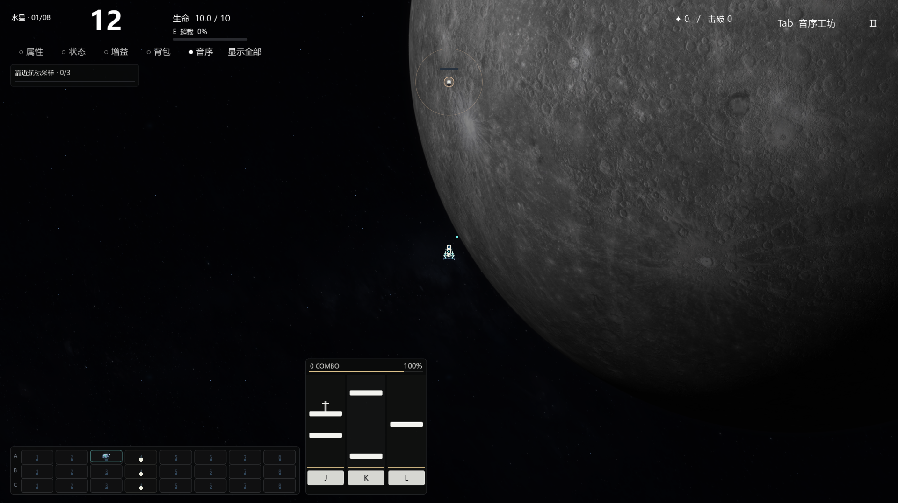

# V58 紧凑音游界面与精简文案

2026-11-17 · `0.58.0-compact-ui` · `codex/compact-rhythm-ui`。
修改前远程备份`codex/backup-20261117-before-compact-ui` / `71f77be7c9f2a3bde08f01694f45a1730ef00555`已上传并核验。

用户认为上一版界面挤占战场，随后指定截图中的所有文字介绍都要删除。本轮仅调整呈现与指针点击几何，不改音游判定、谱面、成绩/奖励、驾驶员/天赋、战斗数值或敌人机制。

## 占屏与琴块

| 视口 | 上一版琴块面板 | 当前面板 | 当前占屏 | 面积缩减 |
| --- | --- | --- | ---: | ---: |
| 1280×720 | 330×368 | 224×232 | 5.64% | 57.2% |
| 1920×1080 | 460×约464 | 260×292 | 3.66% | 约64.5% |
| 2560×1440 | 460×468 | 280×306 | 2.32% | 约60.2% |
| 3440×1440 | 460×468 | 280×306 | 1.73% | 约60.2% |

琴块面板自适应为224–280宽、232–306高，保持音序器右侧、底部对齐；侧边放不下时右上方避让。隐藏音序器时靠右下，恢复按钮保留。实际下落区最短140px，各列宽至少约74px；底部键高32px，音符头高12px（原22px）。绘制和鼠标/触点点击共用`head_rect`与`key_rect`，音符点击竖向保留5px容差，输入时间窗口完全不变。

战斗音序器从最大780×128缩为620×104，小屏约620×96。仍可识别三轨与扫描白点，战斗不新增装备编辑行为。计时器56px白字及战斗顶部透明按钮保留。

## 删除常驻介绍

琴块面板删除歌名、本段得分、P/E/G/M统计、奖励公式、长段连击解释、音乐键编号、早晚毫秒/分数说明、底部结算句与计时。面板没有长说明悬停文本。常驻只保留J/K/L、Combo及弹量百分比/细条；判定和奖励短暂显示在键下窄行，不盖住下落区或中央战机。保护仍标明真实判定，避免把受保护的Miss伪装成命中。

任务HUD由346×94压到276×48，只显示进度摘要与进度线，详细任务提示可悬停查看。机库删长段职责/操作说明，驾驶员显示一行能力摘要（完整效果仍在角色卡悬停）；天赋数值、点数、免费重置、确认按钮保留。图鉴默认显示武器类别、充能、占格与伤害弹数，长机制默认折叠，点击“机制详情”查看。航图精简重复介绍与已废弃流派文案，详细数值折叠为“航线参数”，任务、歌曲、难度和出击入口保留。

主菜单、暂停、设置、机库与图鉴统一中性黑灰表面、白字、细边和小圆角，金色仅作交互/奖励强调。属性/品质/星球/舰队语义色保留。原始战场背景、舰体模型、武器材质/颜色/光晕/尾迹均不替换。

## 验证与限制

[当前验证](data-v58/SUMMARY.json)含1280/1366/1600/1920/2560/3440视口的实测面板几何、120%文字、隐藏/展开音序器、库存布局、键盘/鼠标/触点、12px音符命中、四档判定/Perfect奖励、角色/天赋和存档回归，以及八首完整BGM的时钟/暂停/循环。

本机Godot启动日志报告`Failed to read the root certificate store`（Windows系统证书存储读取提示）。测试未使用HTTPS，离线资源/输入/渲染与本地OGG播放检查均完成；此记录不代表网络证书功能通过，也未修改系统证书。其余错误仍按失败处理。截图是受控测试场景，不代表真人通关或难度/帧率认证。

## 后续顺序

按用户新要求，下一阶段先优化**第一个星球（水星）玩法**，之后再优化**Boss战**。本轮没有实施玩法或Boss数值改动，优先级与后续检查项见[开发顺序](DEVELOPMENT_QUEUE.md)。历史Demo/PPT/私人课程报告保持。
