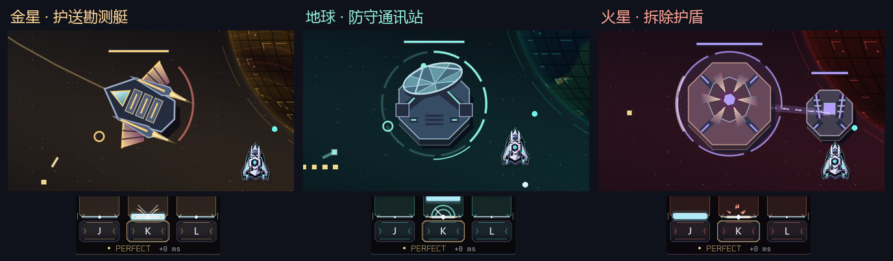

# V78 · 金星护送、地球防守与火星破盾

2026-11-25。开发前远程备份 `cb9c17f48167fb3863ba8c0d76d63b6a06a7edee`。

上排取自实际战斗场景，测试镜头设为 1.35 倍并对准任务物体。下排单独截取同一帧的 K 键判定线。三张图演示了同一种 Perfect 判定。

| 星球 | 在任务中观察什么 | 在琴轨上听到和看到什么 |
| --- | --- | --- |
| 金星 | 护送艇有铜金色太阳翼和双尾喷。击落艇旁专门冲向它的敌机，击落点会向船体送回金色应答。护送艇遭撞时，红色弧线指向来敌。远处的金色云带顺球面弯曲。 | 落键带短金属共鸣，判定线亮起一对向外展开的金翼。 |
| 地球 | 通讯站配有倾斜碟面、接收天线和扫描环。站点激活后，圈内击落普通敌机会点亮一格。三站分别需要 10、15、21 次有效拦截。同帧的多次击落分别计数，声音合并。背景表面可见海岸与港湾灯。 | 落键带短促的无线电回声，判定线出现两道扫描弧。 |
| 火星 | 紫色连线显示哪个发生器仍在供能。打在盾上时，来弹一侧出现亮弧。击毁最后一个发生器后，破裂声与核心位置的冲击环同时出现，机械光圈张开，露出橙红炉芯，此时伤害才会扣除核心生命。星球表面带有峡谷和支脉。 | 低频敲击带一声短裂响。Perfect 迸出五枚碎片，Excellent 为三枚。 |

## 声音与节奏

三关各自替换六类命中音色，包括 Perfect、Excellent、重拍、双押、长按收尾和连打收尾。琴键音量控制三套音色，及时的提前触键也只响一次。漏键、长按中间节点和连击奖励保留共通提示。任务拦截提示间隔至少 220 毫秒，火星同一个核心的盾击间隔至少 150 毫秒。简化特效模式保留判定亮点、任务进度和护盾状态。

[六秒音效对照](data-v78/inner-feedback.wav)按金星（0–2 秒）、地球（2–4 秒）、火星（4–6 秒）排列。每组依次为 Excellent、Perfect、重拍、任务应答或破盾声。试听取自游戏实际生成的声音，独立编排以便比较。接触音使用项目已有的 Kenney CC0 素材。[来源](../audio/authorized/feedback/RHYTHM_CLICKS_SOURCE.json)

三键总分仍每六秒结算一次，八星基础弹量下限为 50%。武器继续按歌曲节拍开火。实机检查覆盖错目标、圈外击杀、同帧拦截、盾面格挡、破盾后掉血以及切回水星时恢复原琴键音色。[检查结果](data-v78/SUMMARY.json)
