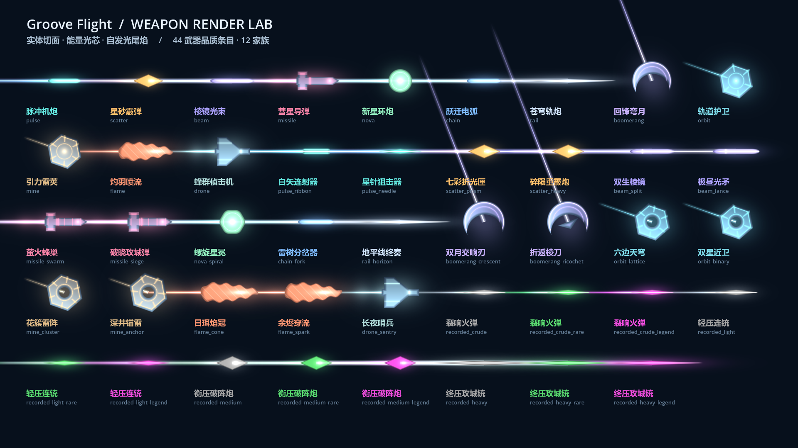

# 武器—弹道—特效—音色对照与10种武器筛选清单

> 2026-11-05最新：用户已确认12种保留武器，当前清单与乐器音色见[V19十二种武器](V19_SELECTED_TWELVE.md)。本页其余数量和试听信息作为历史资料保留。

整理日期：2026-11-05。此表从当前 `arsenal_catalog.gd` 的可用武器导出，包含32种电子武器。**尚未删除任何武器，保留哪10种由用户决定。**

当前规则：3轨×8格，每格0.125秒、一轮1秒；白点到达武器起始格就播放一次该武器的固定声音。不再自动推进四拍强弱或八音旋律；第1–2格与第3–4格的同种武器分别在第1、第3格发声，相隔0.25秒，允许尾音叠加。武器卡片下的拍序状态条已移除。

## 如何看这份清单

- “当前声音”是现有程序合成音源，不是已经采样的真实钢琴、萨克斯或小提琴。
- “乐器候选”仅用于后续讨论，还没有替换或下载；等选定10种武器后，再逐件精修声音和特效。
- 基础数值为单件1级、未加舰体/属性/改件的目录数据；充能保留现有弹体限制，声音每次扫到均固定播放。
- 同家族多款武器共享基础渲染，区别主要来自弹数、散布、速度、穿透、追踪与爆炸等参数。不同名称不代表已经有完全独立的美术。

## 现有特效图

下面是历史渲染图，含当前32种电子武器及暂时隐藏的录音条目。**筛选以本文32种为准**，图中其余录音条目不计入本轮候选。图中弹体为放大展示，不代表完整弹道运动或整局战斗。

[光束、电弧与命中特效图](screenshots/v10-energy-effects.png) · [正式战斗函数调用展示](screenshots/v10-weapons-in-battle.png)

## 32种候选武器

编号沿用当前目录顺序，方便直接回复保留编号或名称。

### 机炮 · 3种

朝瞄准方向直射的青色脉冲弹；窄光芯、短光带，适合清楚的短起音。

| 编号 / 武器 | 基础攻击与区别 | 占格 / 充能 | 当前声音 | 乐器候选（未实装） |
| --- | --- | --- | --- | --- |
| **01 脉冲机炮** `pulse` | 9 × 3；弹速900 | 1格 / 1轮 | 方波电子短音 | 钢琴短击 |
| **13 白矢连射器** `pulse_ribbon` | 5.5 × 6；穿透1 | 2格 / 1轮 | 方波电子短音 | 木琴短音 |
| **14 星针狙击器** `pulse_needle` | 27 × 1；穿透4 | 2格 / 1轮 | 三角波电子音 | 闷音吉他 |

### 霰弹 · 3种

多颗弹丸扇面散射；金色菱形弹芯、短尾迹。

| 编号 / 武器 | 基础攻击与区别 | 占格 / 充能 | 当前声音 | 乐器候选（未实装） |
| --- | --- | --- | --- | --- |
| **02 星砂霰弹** `scatter` | 7 × 5；弹速690 | 1格 / 1轮 | 噪声打击 / 电子音 | 军鼓 |
| **15 七彩折光匣** `scatter_prism` | 11 × 7；穿透1 | 2格 / 2轮 | 噪声打击 / 电子音 | 鼓组短击 |
| **16 碎陨重霰炮** `scatter_heavy` | 22 × 4；穿透2、爆炸半径35 | 2格 / 2轮 | 方波电子短音 | 落地通鼓 |

### 光束 · 3种

瞬时长距离贯穿；紫色高亮内芯、能量鞘和局部辉光。

| 编号 / 武器 | 基础攻击与区别 | 占格 / 充能 | 当前声音 | 乐器候选（未实装） |
| --- | --- | --- | --- | --- |
| **03 棱镜光束** `beam` | 23 × 1；穿透12 | 2格 / 1轮 | 正弦 / FM电子音 | 小提琴长弓 |
| **17 双生棱镜** `beam_split` | 18 × 2；穿透10 | 2格 / 1轮 | 正弦 / FM电子音 | 双声弦乐 |
| **18 极昼光矛** `beam_lance` | 160 × 1；穿透28、爆炸半径50 | 3格 / 8轮 | 正弦 / FM电子音 | 大提琴长音 |

### 导弹 · 3种

有装甲弹头、稳定翼与玫红尾焰；追踪目标并爆炸。

| 编号 / 武器 | 基础攻击与区别 | 占格 / 充能 | 当前声音 | 乐器候选（未实装） |
| --- | --- | --- | --- | --- |
| **04 彗星导弹** `missile` | 28 × 1；追踪、爆炸半径110 | 2格 / 1轮 | 锯齿波电子音 | 底鼓 |
| **19 萤火蜂巢** `missile_swarm` | 15 × 5；追踪、爆炸半径70 | 2格 / 2轮 | 锯齿波电子音 | 铜管短音 |
| **20 破晓攻城弹** `missile_siege` | 170 × 1；追踪、爆炸半径235 | 3格 / 8轮 | 锯齿波电子音 | 定音鼓 |

### 环炮 · 2种

向四周发射环形弹幕；绿色球核、环形饰边。

| 编号 / 武器 | 基础攻击与区别 | 占格 / 充能 | 当前声音 | 乐器候选（未实装） |
| --- | --- | --- | --- | --- |
| **05 新星环炮** `nova` | 10 × 10；弹速560 | 2格 / 1轮 | 三角波电子音 | 萨克斯短音 |
| **21 螺旋星冕** `nova_spiral` | 13 × 16；穿透1 | 3格 / 2轮 | 三角波电子音 | 萨克斯＋电钢琴 |

### 电弧 · 2种

敌人之间连续连跳；蓝色折线电流、副弧与局部闪光。

| 编号 / 武器 | 基础攻击与区别 | 占格 / 充能 | 当前声音 | 乐器候选（未实装） |
| --- | --- | --- | --- | --- |
| **06 跃迁电弧** `chain` | 19 × 1；连跳/反弹3 | 2格 / 1轮 | 正弦 / FM电子音 | 颤音琴 |
| **22 雷树分岔器** `chain_fork` | 32 × 2；连跳/反弹6 | 3格 / 4轮 | 正弦 / FM电子音 | 木琴装饰音 |

### 轨炮 · 2种

高速窄束贯穿；银白锐光弹、细长高亮光带。

| 编号 / 武器 | 基础攻击与区别 | 占格 / 充能 | 当前声音 | 乐器候选（未实装） |
| --- | --- | --- | --- | --- |
| **07 苍穹轨炮** `rail` | 58 × 1；穿透7 | 2格 / 2轮 | 三角波电子音 | 低音钢琴 |
| **23 地平线终奏** `rail_horizon` | 195 × 1；穿透36、爆炸半径45 | 3格 / 8轮 | 三角波电子音 | 钢琴低音重击 |

### 回旋刃 · 3种

淡紫实体月牙刃，飞出后折返；部分型号还能弹跳。

| 编号 / 武器 | 基础攻击与区别 | 占格 / 充能 | 当前声音 | 乐器候选（未实装） |
| --- | --- | --- | --- | --- |
| **08 回锋弯月** `boomerang` | 18 × 1；穿透2、连跳/反弹1 | 1格 / 1轮 | 三角波电子音 | 木吉他拨弦 |
| **24 双月交响刃** `boomerang_crescent` | 21 × 2；穿透3、连跳/反弹1 | 2格 / 2轮 | 三角波电子音 | 古典吉他 |
| **25 折返棱刀** `boomerang_ricochet` | 25 × 1；穿透1、连跳/反弹4 | 2格 / 2轮 | 方波电子短音 | 电吉他拨弦 |

### 轨道卫星 · 3种

贴近飞船持续护卫的蓝绿色卫星；六角装甲、环形边光与旋转部件。

| 编号 / 武器 | 基础攻击与区别 | 占格 / 充能 | 当前声音 | 乐器候选（未实装） |
| --- | --- | --- | --- | --- |
| **09 轨道护卫** `orbit` | 9 × 3；穿透4 | 2格 / 2轮 | 正弦 / FM电子音 | 柔和弦乐 |
| **26 六边天穹** `orbit_lattice` | 12 × 6；穿透6 | 3格 / 4轮 | 正弦 / FM电子音 | 大提琴＋合成器 |
| **27 双星近卫** `orbit_binary` | 24 × 2；穿透10、爆炸半径30 | 2格 / 2轮 | 三角波电子音 | 双声弦乐 |

### 地雷 · 3种

慢速部署后衰减停留的雷荚；黄铜色六角装甲，爆炸时出现冲击环与火花。

| 编号 / 武器 | 基础攻击与区别 | 占格 / 充能 | 当前声音 | 乐器候选（未实装） |
| --- | --- | --- | --- | --- |
| **10 引力雷荚** `mine` | 38 × 2；爆炸半径125 | 1格 / 2轮 | 方波电子短音 | 低音大鼓 |
| **28 花簇雷阵** `mine_cluster` | 20 × 6；爆炸半径95 | 2格 / 4轮 | 噪声打击 / 电子音 | 通鼓 |
| **29 深井锚雷** `mine_anchor` | 120 × 1；爆炸半径260 | 3格 / 4轮 | 正弦 / FM电子音 | 低锣 / 大鼓 |

### 焰流 · 3种

短程等离子火舌与余烬；橙红分层外壳、流动热纹、明亮焰芯。

| 编号 / 武器 | 基础攻击与区别 | 占格 / 充能 | 当前声音 | 乐器候选（未实装） |
| --- | --- | --- | --- | --- |
| **11 灼羽喷流** `flame` | 4 × 6；穿透2 | 1格 / 1轮 | 噪声打击 / 电子音 | 电吉他短音 |
| **30 日珥焰冠** `flame_cone` | 7 × 10；穿透3 | 2格 / 2轮 | 噪声打击 / 电子音 | 轻失真吉他 |
| **31 余烬穿流** `flame_spark` | 13 × 3；穿透5、爆炸半径35 | 2格 / 1轮 | 锯齿波电子音 | 电子拨弦 |

### 无人机 · 2种

长存续追踪蜂群；浅青三角机翼、座舱灯、金属切面与推进光。

| 编号 / 武器 | 基础攻击与区别 | 占格 / 充能 | 当前声音 | 乐器候选（未实装） |
| --- | --- | --- | --- | --- |
| **12 蜂群侦击机** `drone` | 10 × 2；追踪 | 2格 / 2轮 | 方波电子短音 | 拨弦弦乐 |
| **32 长夜哨兵** `drone_sentry` | 24 × 3；穿透1、追踪、爆炸半径35 | 3格 / 4轮 | 方波电子短音 | 柔和合成器 |

## 选择时可对照的区别

可以按弹道挑选：直射、扇形散射、贯穿光束、追踪导弹、环形弹幕、连锁电弧、回旋、护卫卫星、地雷、焰流、无人机。当前有12个家族，最终只做10种，是否保留全部攻击类型或舍弃其中一些，由用户决定。

也可以按音色组合挑选：钢琴、鼓、萨克斯、小提琴、吉他加部分电子音色，后续分别对应选中的武器。不会为了凑家族或凑乐器种类，自动替用户删减。

用户可以直接给出10个编号或名称，例如“保留01、03……”；在选择完成前，现有32种及全部历史声音素材都保留。

## 资料与代码入口

- [旧版武器特效制作说明](WEAPON_VFX.md)：表面、光芯、尾迹、命中、爆炸及低特效模式；其中版本数量说明属于历史记录。
- [旧版声音与武器矩阵](WEAPON_MUSIC_MATRIX.md)：历史波形和旋律素材参数，当前固定声音规则不使用其中的四拍/八音自动变化。
- [当前32种机器可读目录](data-v18/weapon-selection.json)：源自当前代码，包含各项基础数值与现有合成参数。
- `scripts/arsenal_catalog.gd`：武器ID、名称、弹数、伤害、占格、充能和基础音色参数。
- `scripts/main.gd::fire_weapon()`：真实发射、贯穿、连跳、追踪与爆炸行为。
- `scripts/weapon_render.gd`、`shaders/weapon_body.gdshader`：弹体与光带。
- `scripts/fx.gd`：激光、电弧、炮口、命中和爆炸特效。
